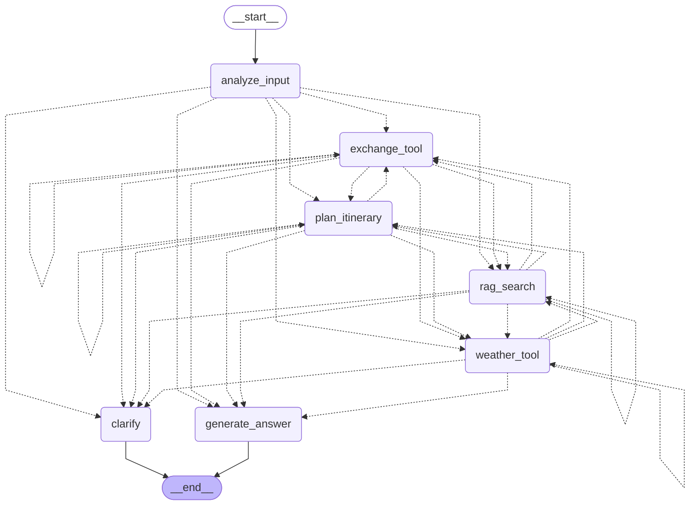

# 스마트 여행 비서 (SmartAI-RAG-Tour)

LangGraph 로 만든 여행 비서 에이전트입니다. 사용자의 질문을 분석해 **가이드 RAG 검색 / 날씨 / 환율** 도구를 필요한 만큼 순서대로 호출하고, 결과를 모아 답변합니다. CLI 와 FastAPI + HTMX 웹 화면(대화 + 실시간 보드)을 함께 제공합니다.

## 1. 과제 개요와 제약 준수

과제 원문은 [`실습과제.txt`](실습과제.txt) 입니다. 핵심 제약과 구현 위치는 다음과 같습니다.

| 요구 / 제약 | 구현 |
|---|---|
| `create_react_agent` 사용 금지 | 사용하지 않음. `StateGraph` 에 노드와 에지를 직접 등록 (`src/graph.py`, 사용 API: `StateGraph`, `add_node`, `add_edge`, `add_conditional_edges`) |
| State 직접 정의 | `TravelState` / `Entities` / `RagDoc` (`src/state.py`) |
| 노드: 입력 분석, RAG, 외부 도구 | `src/nodes/` 아래 독립 함수 6개 |
| 조건부 에지 | `route_by_intent` (분석 직후와 모든 작업 노드 직후 합류) |
| 날씨 / 환율 도구 | `src/tools/` (키가 없거나 실패하면 mock 으로 자동 폴백) |
| RAG, 가이드 문서 5개 | `data/guides/*.txt` (도쿄, 파리, 방콕, 뉴욕, 제주) + FAISS 인덱스 |

## 2. 그래프 도식

`python -m src.graph` 로 다시 만들 수 있고, 원본은 [`develop/graph.mmd`](develop/graph.mmd) 입니다. 점선이 조건부 에지입니다.



## 3. 노드 / 에지 / State 요약

### 노드

| 노드 | 파일 | 역할 |
|---|---|---|
| `analyze_input` | `src/nodes/analyze.py` | 의도(intent)와 엔티티(도시, 금액, 일수, 취향) 추출, 실행할 작업 큐(`pending_intents`) 구성. LLM 구조화 출력, 실패하면 규칙 기반 |
| `rag_search` | `src/nodes/rag_node.py` | 목적지 가이드 검색(FAISS), 도시 필터 후 top-k |
| `weather_tool` | `src/nodes/weather_node.py` | 날씨 조회 (OpenWeather, 키 없으면 mock) |
| `exchange_tool` | `src/nodes/exchange_node.py` | 환율 계산 (open.er-api.com, 실패하면 mock 환율표) |
| `plan_itinerary` | `src/nodes/plan_node.py` | 여행 계획(trip)의 일차별 일정 구성. 규칙 기반, LLM 이 있으면 LLM 후 실패 시 규칙 폴백 |
| `clarify` | `src/nodes/clarify.py` | 정보가 부족할 때 되묻고 종료 |
| `generate_answer` | `src/nodes/respond.py` | 수집한 결과로 최종 답변 생성. LLM 이 없거나 실패하면 템플릿 답변 |

### 에지

| 에지 | 종류 | 설명 |
|---|---|---|
| `START -> analyze_input` | 일반 | 진입 |
| `analyze_input / rag_search / weather_tool / exchange_tool / plan_itinerary -> (route_by_intent)` | 조건부 | 우선순위: `needs_clarification` 이면 `clarify` > `step_count >= MAX_STEPS` 이면 `generate_answer` > 작업 큐의 첫 작업 노드 > `generate_answer` |
| `clarify -> END`, `generate_answer -> END` | 일반 | 종료 |

### State (`TravelState`)

| 필드 | 설명 |
|---|---|
| `messages` | 대화 이력 (`add_messages` 로 누적, 체크포인터가 스레드별 보관) |
| `user_input`, `intent`, `entities` | 현재 입력, 분석된 의도, 엔티티 (엔티티는 턴을 넘어 유지) |
| `pending_intents`, `needs_clarification`, `clarify_question`, `clarify_reason`, `step_count` | 제어 흐름 (작업 큐, 되묻기와 그 사유, 무한 루프 가드) |
| `unsupported_destination` | 이번 턴에 감지된 미지원 지명 (턴마다 초기화) |
| `trip`, `itinerary`, `forecast`, `details` | 여행 계획, 일차별 일정, 여행기간중 날씨현황, 챗봇 상세 요청 카드 (체크포인트에 유지, `details` 는 누적) |
| `plan_request`, `detail_request` | 이번 턴이 계획 생성/상세 요청인지 (턴마다 초기화) |
| `rag_docs`, `weather`, `exchange` | 도구 결과 (턴마다 초기화) |
| `errors`, `final_answer` | 진단 정보, 최종 답변 |

## 4. 폴더 구조

```
Smart-Travel/
├─ main.py                 CLI 진입점 (src/main.py 호출)
├─ requirements.txt        핵심 + 웹 의존성
├─ requirements-web.txt    웹 의존성만 (requirements.txt 에 이미 포함)
├─ requirements-hf.txt     선택: 로컬 HuggingFace 임베딩 (torch 필요, 무거움)
├─ .env.example            환경변수 예시
├─ data/
│  ├─ guides/*.txt          RAG 원본 가이드 5개
│  ├─ index/               FAISS 인덱스 (자동 생성/갱신)
│  └─ threads.sqlite       웹 대화 체크포인트 (자동 생성)
├─ src/
│  ├─ state.py graph.py    State 와 StateGraph 조립
│  ├─ nodes/               analyze, rag, weather, exchange, clarify, respond, router
│  ├─ tools/               weather.py, exchange.py
│  ├─ rag/                 loader, embeddings, index, retriever, text(표시용 정리)
│  ├─ llm.py prompts.py config.py destinations.py
│  └─ web/                 FastAPI 앱: routes, sse, threads, runtime, templates, static
├─ scripts/                build_css.sh / build_css.ps1 (Tailwind 빌드)
├─ tools/bin/              Tailwind standalone CLI (tailwindcss.exe)
├─ tests/                  pytest (외부 네트워크/키 없이 동작)
├─ plans/                  기획서.md, 화면설계.md
├─ develop/                개발서.md, graph.mmd
└─ Designs/                DESIGN.md, COMPONENTS.md, DASHBOARD_*.md
```

## 5. 실행 방법

> 요구 사항: **Python 3.11** (3.11.9 에서 검증), Git. API 키가 하나도 없어도 실행됩니다 (5-3 참고).

### 5-1. 설치

**Windows PowerShell**

```powershell
git clone https://github.com/DevOps0906/SmartAI-RAG-Tour.git
cd SmartAI-RAG-Tour
python -m venv .venv
.venv\Scripts\Activate.ps1               # 실행 정책 오류 시: Set-ExecutionPolicy -Scope CurrentUser RemoteSigned
pip install -r requirements.txt          # 웹 의존성(requirements-web.txt)도 포함
pip install -r requirements-hf.txt       # (권장) 의미 기반 검색용 로컬 임베딩. torch 포함이라 수 분 걸림
Copy-Item .env.example .env
```

**bash (Git Bash / Linux / macOS)**

```bash
git clone https://github.com/DevOps0906/SmartAI-RAG-Tour.git
cd SmartAI-RAG-Tour
python -m venv .venv
source .venv/Scripts/activate            # Linux/macOS 는 source .venv/bin/activate
pip install -r requirements.txt
pip install -r requirements-hf.txt       # (권장) 로컬 임베딩
cp .env.example .env
```

### 5-2. API 키 설정 (`.env`)

| 기능 | 키 | 없을 때 |
|---|---|---|
| LLM 의도 분석, 답변 생성 | `ANTHROPIC_API_KEY` (또는 `LLM_PROVIDER=openai` + `OPENAI_API_KEY`) | 규칙 기반 분석, 템플릿 답변 ("LLM 없이 생성된 요약") |
| 실시간 날씨 | `OPENWEATHER_API_KEY` | mock 날씨 |
| 실시간 환율 | 필요 없음 (open.er-api.com) | 네트워크 실패 시 mock 환율 |

`.env` 는 `.gitignore` 에 포함되어 커밋되지 않습니다. 키는 `.env` 에만 넣으세요.

### 5-3. RAG 인덱스 만들기

가이드 문서는 `data/guides/*.txt` 5개이고, FAISS 인덱스(`data/index/`)는 저장소에 포함되지 않습니다. 첫 실행 때 자동으로 만들어지지만, 미리 만들어 두면 첫 응답이 빨라집니다.

```bash
python -m src.rag.index --rebuild
# 출력 예: 인덱스 준비 완료: 45개 청크 (embedding=huggingface)
```

- `embedding=huggingface` 로 나오면 정상입니다. 첫 빌드 때 임베딩 모델(`intfloat/multilingual-e5-small`)을 내려받습니다.
- `embedding=hash` 로 나오면 `requirements-hf.txt` 가 설치되지 않은 상태입니다. 동작은 하지만 의미 기반 검색이 아니므로 "여름 휴양지 추천" 같은 질문의 품질이 떨어집니다. 처음부터 가볍게 쓰려면 `.env` 에서 `EMBEDDING_PROVIDER=hash` 로 두세요.
- 가이드 파일이나 임베딩·청킹 설정이 바뀌면 다음 실행 때 자동으로 다시 빌드됩니다.

### 5-4. 실행

**CLI**

```bash
python main.py                                         # 대화형 (종료: quit, exit, q)
python main.py --once "도쿄 날씨 알려줘" --trace       # 질문 하나 + 노드 실행 경로 출력
python main.py --plan "도쿄" --start 2026-10-20 --days 4 --places "아사쿠사,시부야" --trace
```

| 옵션 | 설명 |
|---|---|
| `--trace` | 노드 실행 순서와 State 변화 출력 |
| `--once "질문"` | 질문 하나만 처리하고 종료 |
| `--plan 여행지` | 여행 계획 생성 (`--start YYYY-MM-DD`, `--days 1~5` 기본 3, `--places "장소,장소"` 비우면 AI 추천) |

`--trace` 출력 예:

```
[trace] analyze_input: intent=multi, pending=['rag', 'weather', 'exchange']
[trace] rag_search: docs=5, pending=['weather', 'exchange']
[trace] weather_tool: weather=ok(live), pending=['exchange']
[trace] exchange_tool: exchange=ok(live), pending=[]
[trace] generate_answer
```

**웹**

```bash
uvicorn src.web.app:app --port 8765
```

- 랜딩: http://localhost:8765
- 여행 작업실: http://localhost:8765/planner
- 노드 실행 흐름 보기: http://localhost:8765/planner?debug=1
- 단일 프로세스를 전제로 합니다 (`--workers` 를 늘리지 마세요). CSS 를 수정했을 때만 `scripts/build_css.ps1` (또는 `bash scripts/build_css.sh`) 로 다시 빌드합니다.

### 5-5. 문제 해결

| 증상 | 해결 |
|---|---|
| 답변에 "(LLM 없이 생성된 요약)" 이 붙음 | `.env` 의 `ANTHROPIC_API_KEY` 가 비어 있음 |
| "hash 임베딩으로 대체합니다" 경고 | `pip install -r requirements-hf.txt` 후 `python -m src.rag.index --rebuild` |
| pip 설치 중 `WinError 32` (다른 프로세스가 파일 사용 중) | 실행 중인 서버, pip 를 모두 종료한 뒤 다시 설치 |
| PowerShell 에서 `Activate.ps1` 실행 불가 | `Set-ExecutionPolicy -Scope CurrentUser RemoteSigned` |
| 콘솔 한글 깨짐 (Windows) | `$env:PYTHONIOENCODING="utf-8"` 설정 후 실행 |
| 포트 8765 사용 중 | `--port` 를 다른 번호로 |

### 5-6. 웹 사용 흐름 (랜딩과 여행 계획 모달)

서버를 열면 먼저 **랜딩(`/`)** 이 나옵니다(히어로, 인기 코스). 상단 로고는 항상 랜딩으로 돌아가고, 작업실은 **여행 작업실**(`/planner`)입니다. 만든 계획은 이 브라우저의 localStorage(`smart-travel:plans`)에 저장되어 랜딩의 "내 여행 계획"에서 다시 열 수 있습니다("이 기기에서 삭제"로 지울 수 있음).

헤더의 **새 여행 계획** 버튼(또는 빈 보드의 CTA)을 누르면 팝업이 열립니다. 여행지(5곳) → 출발일과 여행 일수(1~5일차 버튼, 기본 3일차) → 가고 싶은 장소(칩 선택 또는 직접 입력, 비우면 AI 추천)를 고르고 **계획 만들기**를 누르면, 새 대화로 이동해 일정, 여행기간중 날씨현황, 환율, 가이드가 보드에 채워집니다. 이후 챗봇에 "2일차 맛집 더 알려줘", "교통 자세히"처럼 물으면 보드의 **요청한 정보**에 카드로 쌓입니다. 실행 흐름(노드·상태·ms)은 `http://localhost:8765/planner?debug=1` 에서만 보입니다.

계획 생성 경로: `analyze_input → rag_search → weather_tool → exchange_tool → plan_itinerary → generate_answer`. 예보 범위(약 5일) 밖 날짜는 가이드의 계절 설명("예상 기후")으로 표시합니다.

## 6. 환경변수 (`.env.example` 기준)

| 변수 | 기본값 | 설명 |
|---|---|---|
| `LLM_PROVIDER` | `anthropic` | `anthropic` / `openai` / `none`. 키가 없으면 LLM 없이 동작 |
| `LLM_MODEL` | `claude-sonnet-5-5` | 모델 이름 |
| `ANTHROPIC_API_KEY`, `OPENAI_API_KEY` | 빈 값 | LLM 키 |
| `EMBEDDING_PROVIDER` | `huggingface` | `huggingface` / `openai` / `hash` (패키지 없으면 hash 로 폴백) |
| `EMBEDDING_MODEL` | `intfloat/multilingual-e5-small` | 임베딩 모델 |
| `OPENWEATHER_API_KEY` | 빈 값 | 없으면 날씨 mock |
| `WEATHER_MODE`, `EXCHANGE_MODE` | `auto` | `auto` 는 실시간 시도 후 실패 시 mock, `mock` 은 항상 mock |
| `EXCHANGE_API_BASE` | `https://open.er-api.com/v6/latest` | 환율 API (무키) |
| `GUIDES_DIR`, `RAG_INDEX_DIR` | 빈 값 | 비우면 `data/guides`, `data/index` |
| `RAG_TOP_K`, `RAG_CHUNK_SIZE`, `RAG_CHUNK_OVERLAP` | 4 / 500 / 80 | 검색/청킹 설정 |
| `HTTP_TIMEOUT` | 5 | 외부 API 타임아웃(초) |
| `MAX_STEPS` | 8 | 한 턴에서 작업 노드를 최대 몇 번 실행할지 (무한 루프 가드) |
| `WEB_CHECKPOINT` | `sqlite` | `sqlite` / `memory` |
| `WEB_DB_PATH` | 빈 값 | 비우면 `data/threads.sqlite` |

## 7. 테스트

```powershell
.venv\Scripts\python -m pytest -q       # Windows
```

```bash
.venv/Scripts/python -m pytest -q        # bash (Linux/macOS 는 .venv/bin/python)
```

테스트는 LLM 없음, hash 임베딩, mock 날씨/환율로 고정되어 키나 네트워크 없이 통과합니다 (`tests/conftest.py`).

## 8. 시연 시나리오

`python main.py --once "<질문>" --trace` 의 `경로` 줄로 확인할 수 있습니다. (LLM 이 없을 때 규칙 기반 기준)

| # | 질문 | 기대 노드 경로 |
|---|---|---|
| 1 | 도쿄 3박 4일 일정이랑 날씨 알려주고, 50만원이면 엔화로 얼마인지도 알려줘 | analyze_input -> rag_search -> weather_tool -> exchange_tool -> generate_answer |
| 2 | 방콕 날씨 어때? | analyze_input -> weather_tool -> generate_answer |
| 3 | 5월에 맛집 위주로 갈 도시 추천해줘 | analyze_input -> rag_search -> generate_answer |
| 4 | 파리 100만원이면 몇 유로야? | analyze_input -> exchange_tool -> generate_answer |
| 5 | 어디 갈까? (정보 부족) | analyze_input -> clarify |

웹에서는 같은 질문을 보내면 오른쪽 대화 패널에 답변이, 보드에 날씨/환율/가이드/일정 카드가 실시간으로 채워지고, 실행 흐름(노드별 상태와 시간)이 함께 표시됩니다. 대화는 왼쪽 목록에서 다시 열 수 있습니다.

## 9. 문서

- 기획: [`plans/기획서.md`](plans/기획서.md), [`plans/화면설계.md`](plans/화면설계.md)
- 개발: [`develop/개발서.md`](develop/개발서.md), [`develop/graph.mmd`](develop/graph.mmd)
- 디자인: [`Designs/DESIGN.md`](Designs/DESIGN.md), [`Designs/COMPONENTS.md`](Designs/COMPONENTS.md), [`Designs/DASHBOARD_PATTERNS.md`](Designs/DASHBOARD_PATTERNS.md), [`Designs/DASHBOARD_VISUAL.md`](Designs/DASHBOARD_VISUAL.md)

## 10. 알려진 한계

- 키가 없으면 의도 분석은 규칙 기반, 답변은 템플릿(가이드 문장을 정리해 이어 붙인 요약)이라 자연스러움과 복합 질문 이해가 제한됩니다.
- `hash` 임베딩은 검색 의미 품질이 낮습니다. 품질이 필요하면 `requirements-hf.txt` 설치 후 `EMBEDDING_PROVIDER=huggingface` 를 쓰세요 (모델 다운로드와 torch 필요).
- 환율은 실시간 조회 시 값이 계속 변하고 은행 수수료를 반영하지 않는 참고용입니다. 조회에 실패하면 고정 환율표(mock)로 대체되며 화면에 "고정 환율"로 표시됩니다. 날씨 mock 도 참고용 예상치입니다.
- 지원 도시는 가이드 5곳(도쿄, 파리, 방콕, 뉴욕, 제주)이고 통화는 JPY, EUR, THB, USD, KRW 입니다. 그 밖의 나라·도시를 말하면 "아직 존재하지 않습니다"라고 안내하고 선택 가능한 여행지를 보여 줍니다.

### 여행지 추가 방법

여행지 목록의 단일 정답은 `src/destinations.py` 의 `DESTINATIONS` 입니다. 보드의 선택 카드, 날씨·환율, 미지원 안내가 모두 이것을 따릅니다.

1. `data/guides/{key}.txt` 를 규격대로 작성합니다 (개발서 9.2).
2. `DESTINATIONS` 에 항목을 추가합니다: `key`, `ko`(도시 한글명), `country`, `currency`, `lat`/`lon`, `intro`(한 줄 소개), `guide`(파일명), `enabled=True`, `aliases`.
3. 그 도시를 `UNSUPPORTED_PLACES` 에 넣어 두었다면 지워도 되고, 그대로 둬도 지원 별칭과 겹치면 자동으로 제외됩니다.
4. `data/index/` 를 지워 인덱스를 다시 만듭니다. 선택 카드와 안내 문구는 코드 수정 없이 늘어납니다. 새 통화는 `src/tools/exchange.py` 의 환율표(mock)에도 추가하세요.
5. `enabled=False` 이거나 가이드 파일이 없으면 선택지에서 빠집니다 (`supported_destinations()`).
- 웹은 단일 프로세스 전제입니다. 접수된 메시지(`PENDING`)와 실행 중 표시(`RUNNING`)를 프로세스 메모리에 두므로 여러 워커로 띄우면 동작하지 않습니다. 인증과 사용자 분리도 없습니다.
- 왼쪽 "내 여행 기록"은 체크포인트(sqlite)의 모든 대화를 최근 순으로 30개씩 보여 주고(더 보기), 항목을 누르면 페이지 이동 없이 그 계획으로 바뀝니다. 항목의 "기록에서 삭제"는 서버 기록과 이 기기의 사본을 함께 지웁니다. 챗봇을 닫아도 보드는 그대로이고 진행 중인 응답은 계속 보드를 갱신합니다. 작업실에서 새 여행 계획을 만들면 완료 후에 화면이 새 계획으로 바뀝니다.
