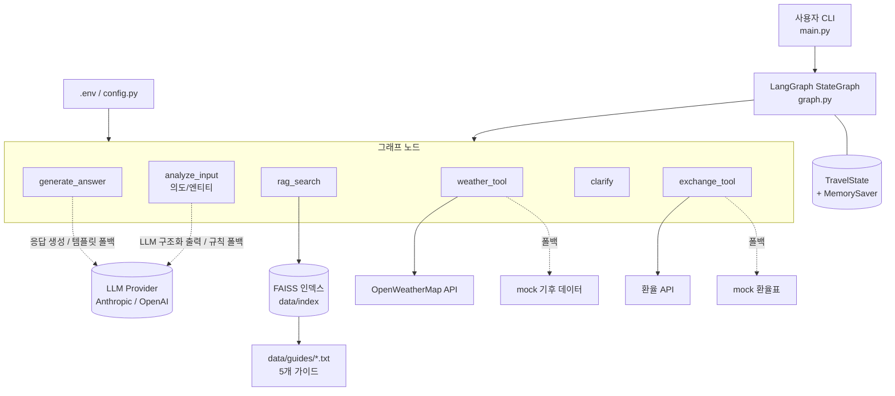
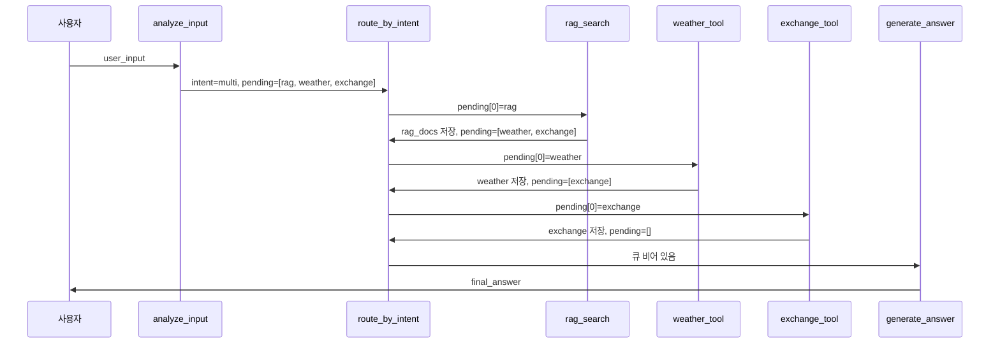
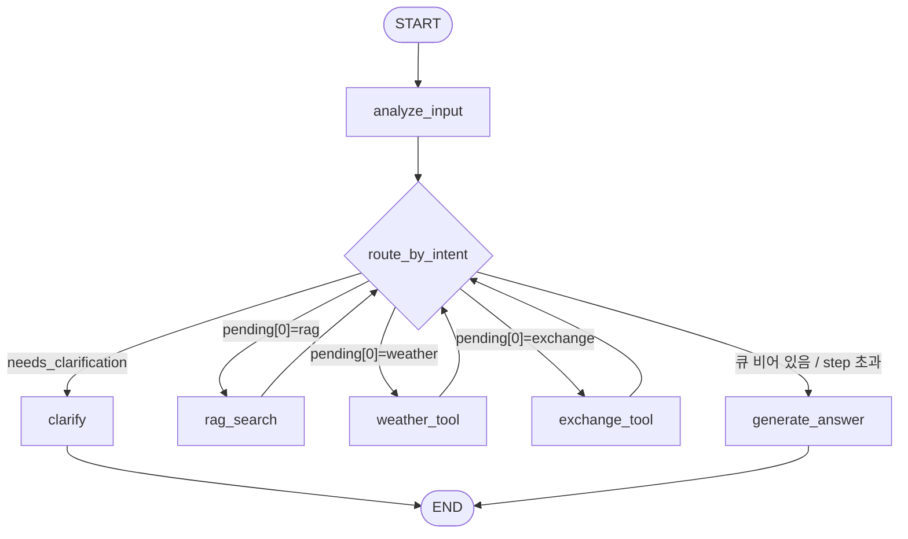

# 스마트 여행 비서 에이전트 개발서 (기술 설계서)

| 항목 | 내용 |
|---|---|
| 문서명 | LangGraph 기반 스마트 여행 비서 에이전트 개발서 |
| 대상 과제 | `실습과제.txt` - LangGraph를 활용한 스마트 여행 비서 에이전트 구축 |
| 문서 버전 | v1.0 |
| 작성일 | 2026-10-16 |
| 관련 문서 | 기획서(`plans/기획서.md`, 별도 작성) |

---

## 1. 개요

### 1.1 목적
사용자의 자연어 질의를 분석해 **여행지 추천(RAG)**, **날씨 조회**, **환율 계산**, **일정 구성**을 수행하는 여행 비서 에이전트를 LangGraph의 저수준 API(`StateGraph`, `add_node`, `add_edge`, `add_conditional_edges`)만으로 구현한다.

### 1.2 핵심 제약
- `create_react_agent` 등 고수준 prebuilt 에이전트 사용 금지 (NFR-01). 상태/노드/에지를 직접 정의한다.
- 조건부 에지(Conditional Edge)를 반드시 포함한다.
- RAG 문서는 직접 작성한 여행 가이드 txt 5개(도쿄, 파리, 방콕, 뉴욕, 제주)를 사용한다.
- 외부 API 키는 `.env`로 관리하며 코드/저장소에 노출하지 않는다 (NFR-03).

### 1.3 설계 원칙
1. **결정적 제어 흐름**: LLM은 "의도/엔티티 추출"과 "최종 문장 생성"에만 사용하고, 어떤 노드를 실행할지는 State(`pending_intents`)를 읽는 순수 라우터 함수가 결정한다. 따라서 라우팅은 단위 테스트가 가능하다.
2. **항상 종료**: 모든 작업 노드는 실패해도 자신의 task를 큐에서 제거하고, `step_count` 상한으로 무한 루프를 방지한다.
3. **오프라인 동작 가능**: LLM 키/날씨 키/네트워크가 없어도 규칙 기반 분석 + mock Tool + 템플릿 응답으로 끝까지 실행된다 (테스트와 데모 안정성).
4. **복합 의도는 큐로 순차 처리**: `multi` 의도는 `pending_intents` 큐에 작업을 쌓고, 작업 노드 실행 후 같은 라우터로 되돌아와 다음 작업을 꺼낸다 (FR-06).

### 1.4 범위
| 구분 | 내용 |
|---|---|
| 범위 내 | CLI 대화형 에이전트, 웹 UI(FastAPI + HTMX, 17장), 5개 도시 가이드 RAG, 날씨/환율 Tool, 조건부 라우팅, 다중 턴 컨텍스트(MemorySaver) |
| 범위 외 | 항공/숙박 예약, 5개 외 도시, 사용자 인증, 원화 기준 외 환산은 `"100달러"`처럼 외화 금액을 말한 경우의 외화->KRW 단방향만 지원 |

---

## 2. 기술 스택

### 2.1 런타임/라이브러리
| 구분 | 패키지 | 권장 버전(범위) | 용도 |
|---|---|---|---|
| 언어 | Python | 3.11 이상 (3.12 검증 권장) | `X \| None` 타입 문법, `tomllib` 등 |
| 오케스트레이션 | `langgraph` | `>=0.2.60,<2.0` | StateGraph, 체크포인터(MemorySaver) |
| 코어 | `langchain-core` | `>=0.3.30,<2.0` | 메시지, `@tool`, Document, Embeddings 인터페이스 |
| LLM (택1) | `langchain-anthropic` | `>=0.3.0,<2.0` | ChatAnthropic (기본) |
| LLM (택1) | `langchain-openai` | `>=0.3.0,<2.0` | ChatOpenAI, OpenAIEmbeddings |
| 커뮤니티 | `langchain-community` | `>=0.3.14,<1.0` | FAISS 벡터스토어 래퍼 |
| 텍스트 분할 | `langchain-text-splitters` | `>=0.3.4,<2.0` | RecursiveCharacterTextSplitter |
| 임베딩(로컬 옵션) | `langchain-huggingface`, `sentence-transformers` | `>=0.1.2`, `>=3.0` | `intfloat/multilingual-e5-small` |
| 벡터 인덱스 | `faiss-cpu` | `>=1.8.0` | 로컬 유사도 검색 (Chroma로 대체 가능) |
| HTTP | `httpx` | `>=0.27,<1.0` | 날씨/환율 REST 호출 |
| 검증 | `pydantic` | `>=2.7,<3.0` | 구조화 출력(분석 결과) |
| 환경변수 | `python-dotenv` | `>=1.0.1` | `.env` 로딩 |
| 테스트 | `pytest` | `>=8.2` | 단위/통합 테스트 |
| 웹 서버 | `fastapi`, `uvicorn[standard]` | `>=0.115,<1.0`, `>=0.30` | 웹 계층(17장) |
| 템플릿 | `jinja2` | `>=3.1` | 서버 렌더링 템플릿 |
| 체크포인터 | `langgraph-checkpoint-sqlite` | `>=2.0` | 웹 대화 기억(SqliteSaver, 17장) |

> 위 범위는 설계 기준이다. 실제 검증된 설치 버전(2026-10-16, Python 3.11.9): langgraph 1.2.15, langchain-core 1.6.11, langchain-anthropic 1.7.6, langchain-openai 1.7.2, langchain-community 0.4.2, langchain-text-splitters 1.1.3, faiss-cpu 1.15.1, langgraph-checkpoint-sqlite 3.1.2, pydantic 2.14.1, httpx 0.28.1, pytest 9.1.1. 정확한 고정은 `pip freeze > requirements.lock`으로 한다.
> 무거운 로컬 임베딩(`langchain-huggingface`, `sentence-transformers`)은 `requirements-hf.txt`로 분리했다. 설치하지 않고 `EMBEDDING_PROVIDER=huggingface`를 쓰면 hash 임베딩으로 자동 폴백(경고 로그)한다.

### 2.2 선택 가이드
| 선택 항목 | 기본값 | 대안 | 비고 |
|---|---|---|---|
| LLM | Anthropic (`LLM_PROVIDER=anthropic`) | OpenAI, `none`(LLM 없이 규칙/템플릿) | `none`은 테스트·오프라인 용 |
| 임베딩 | `huggingface` 로컬 다국어 모델 | `openai`, `hash`(오프라인 결정적 임베딩) | Anthropic은 임베딩 API가 없으므로 별도 선택 필요 |
| 벡터스토어 | FAISS | Chroma | 소규모(수십 청크)라 FAISS 로컬 파일로 충분 |
| 날씨 | OpenWeatherMap (키 있을 때) | mock | 키 없음/호출 실패 시 mock 폴백 |
| 환율 | open.er-api.com (무키) | mock 고정 환율 | 실패 시 mock 폴백 |

### 2.3 requirements.txt / requirements-hf.txt
```text
langgraph>=0.2.60,<2.0
langchain-core>=0.3.30,<2.0
langchain-anthropic>=0.3.0,<2.0
langchain-openai>=0.3.0,<2.0
langchain-community>=0.3.14,<1.0
langchain-text-splitters>=0.3.4,<2.0
faiss-cpu>=1.8.0
httpx>=0.27,<1.0
pydantic>=2.7,<3.0
python-dotenv>=1.0.1
pytest>=8.2
fastapi>=0.115,<1.0
uvicorn[standard]>=0.30,<1.0
jinja2>=3.1,<4.0
python-multipart>=0.0.9
langgraph-checkpoint-sqlite>=2.0
```
```text
# requirements-hf.txt (선택, 무거움: torch 포함)
-r requirements.txt
langchain-huggingface>=0.1.2
sentence-transformers>=3.0
```
> `requirements*.txt`는 Windows 기본 코덱(cp949)에서 pip가 읽을 수 있도록 ASCII 주석만 쓴다.

---

## 3. 시스템 아키텍처

### 3.1 논리 구성


### 3.2 실행 흐름 요약
1. `main.py`가 사용자 입력을 받아 턴 단위 초기 State를 만들어 `graph.invoke` 호출.
2. `analyze_input`이 의도/엔티티를 추출하고 `pending_intents` 큐를 구성.
3. 조건부 에지 `route_by_intent`가 큐의 맨 앞 작업을 해당 노드로 보냄 (`rag_search` / `weather_tool` / `exchange_tool`). 필수 엔티티가 없으면 `clarify`.
4. 작업 노드는 결과를 State에 쓰고 자신의 task를 큐에서 제거한 뒤 다시 `route_by_intent`로 합류.
5. 큐가 비면 `generate_answer`가 모든 결과를 종합해 최종 답변 생성 후 종료.

### 3.3 시퀀스 (복합 의도 예: "도쿄 날씨랑 환율 알려주고 일정 짜줘")


---

## 4. 디렉터리 구조

```text
Smart-Travel/
├─ .env.example
├─ .gitignore                  # .env, data/index/ 제외
├─ main.py                     # CLI 실행 진입점 (src/main.py 의 main 호출)
├─ requirements.txt
├─ requirements-hf.txt         # 선택: 로컬 HF 임베딩
├─ pytest.ini
├─ 실습과제.txt
├─ plans/
│  ├─ 기획서.md
│  └─ 화면설계.md
├─ Designs/                    # 디자인 가이드(DASHBOARD_PATTERNS/VISUAL, DESIGN, COMPONENTS)
├─ develop/
│  ├─ 개발서.md
│  └─ graph.mmd                # python -m src.graph 로 생성한 도식
├─ data/
│  ├─ guides/
│  │  ├─ tokyo.txt
│  │  ├─ paris.txt
│  │  ├─ bangkok.txt
│  │  ├─ newyork.txt
│  │  └─ jeju.txt
│  └─ index/                   # FAISS 인덱스(자동 생성, git 제외)
├─ src/
│  ├─ __init__.py
│  ├─ config.py                # Settings, .env 로딩 (NFR-03)
│  ├─ llm.py                   # LLM 팩토리, LLMUnavailable
│  ├─ destinations.py          # 도시 메타(별칭/통화/좌표) + 정규화
│  ├─ state.py                 # TravelState (FR-01)
│  ├─ prompts.py               # 분석/응답 프롬프트
│  ├─ graph.py                 # StateGraph 조립 (NFR-01)
│  ├─ main.py                  # CLI 진입점
│  ├─ nodes/
│  │  ├─ __init__.py
│  │  ├─ common.py             # pop_task 등 공용 헬퍼
│  │  ├─ analyze.py            # analyze_input (FR-02)
│  │  ├─ rag_node.py           # rag_search (FR-03)
│  │  ├─ weather_node.py       # weather_tool 노드 (FR-04)
│  │  ├─ exchange_node.py      # exchange_tool 노드 (FR-05)
│  │  ├─ clarify.py            # 누락 정보 되묻기
│  │  ├─ respond.py            # generate_answer (FR-07)
│  │  └─ router.py             # route_by_intent (FR-06)
│  ├─ tools/
│  │  ├─ __init__.py
│  │  ├─ weather.py            # @tool get_weather
│  │  └─ exchange.py           # @tool convert_currency
│  ├─ rag/
│  │  ├─ __init__.py
│  │  ├─ loader.py             # 로딩 + 청킹
│  │  ├─ embeddings.py         # 임베딩 팩토리 + HashEmbeddings
│  │  ├─ index.py              # 인덱스 빌드/로드 (CLI: --rebuild)
│  │  └─ retriever.py          # search_guides
│  └─ web/                     # 웹 계층 (17장)
│     ├─ app.py                # FastAPI 앱, Jinja2Templates, 정적 파일
│     ├─ routes.py             # /, /planner, /search, /plan, /plan/{id}.json, /plan/offline, /chat, /chat/stream, /threads, /dev/components
│     ├─ sse.py                # graph.astream -> SSE 이벤트 변환
│     ├─ templates/
│     │  ├─ base.html, index.html
│     │  ├─ partials/          # 보드 카드, 메시지, 실행 흐름, 사이드바
│     │  ├─ components/        # Jinja 매크로(button, card, badge, chip ...)
│     │  └─ dev/components.html
│     └─ static/
│        ├─ css/ (tokens.css, app.src.css, app.css)
│        └─ js/ (htmx, htmx-ext-sse, 버전 고정)
└─ tests/
   ├─ conftest.py
   ├─ test_analyze.py
   ├─ test_router.py
   ├─ test_tools.py
   ├─ test_rag.py
   ├─ test_state.py
   ├─ test_static.py           # T-22, T-23
   ├─ test_graph_e2e.py
   └─ test_web.py              # 웹 계층 (17장, T-25~)
```

---

## 5. State 스키마 (FR-01)

### 5.1 코드 (`src/state.py`)
```python
"""에이전트 전역 상태 정의. (FR-01)"""
from typing import Annotated, Literal, Optional, TypedDict

from langchain_core.messages import AnyMessage
from langgraph.graph.message import add_messages

Intent = Literal["recommend", "weather", "exchange", "itinerary", "multi", "unknown"]
Task = Literal["rag", "weather", "exchange"]


class Entities(TypedDict, total=False):
    destination: Optional[str]      # 정규화 키: tokyo|paris|bangkok|newyork|jeju
    destination_ko: Optional[str]   # 표시용 한글명
    amount: Optional[float]         # 환전 금액 (기본 KRW)
    amount_currency: Optional[str]  # amount 의 통화 (기본 KRW, "100달러" 면 USD)
    amount_assumed: bool            # 금액 미지정으로 기본값(100만원)을 가정했는지
    currency: Optional[str]         # 목적지 통화 코드 (JPY, EUR ...)
    travel_date: Optional[str]      # YYYY-MM-DD
    days: Optional[int]             # 여행 일수
    interests: list[str]            # 취향 키워드 (맛집, 휴양, 쇼핑 ...)


class RagDoc(TypedDict):
    content: str
    city: str
    section: str
    source: str
    score: float                    # FAISS L2 거리 (낮을수록 유사)


class TravelState(TypedDict, total=False):
    # 대화/입력
    messages: Annotated[list[AnyMessage], add_messages]
    user_input: str
    # 분석 결과
    intent: Intent
    entities: Entities
    # 제어 흐름
    pending_intents: list[Task]
    needs_clarification: bool
    clarify_question: str
    clarify_reason: Optional[str]           # None | "unsupported_destination"
    unsupported_destination: Optional[str]  # 이번 턴의 미지원 지명 ("런던, 로마")
    step_count: int
    # 작업 결과
    rag_docs: list[RagDoc]
    weather: Optional[dict]
    exchange: Optional[dict]
    # 출력/진단
    errors: list[str]
    final_answer: str
```

### 5.2 필드 명세
| 필드 | 타입 | 쓰는 노드 | 읽는 노드 | 리듀서 | 턴 시작 초기화 | 설명 |
|---|---|---|---|---|---|---|
| `messages` | `list[AnyMessage]` | main(입력), respond/clarify(출력) | respond | `add_messages` (누적) | X (누적) | 다중 턴 대화 이력 |
| `user_input` | `str` | main | analyze | 덮어쓰기 | O | 현재 턴 사용자 발화 |
| `intent` | `Intent` | analyze | respond | 덮어쓰기 | O | recommend/weather/exchange/itinerary/multi (+ unknown 폴백) |
| `entities` | `Entities` | analyze | rag/weather/exchange/respond | 덮어쓰기 | X | 추출 엔티티. 이전 턴 목적지를 후속 질문에 재사용하기 위해 유지 |
| `pending_intents` | `list[Task]` | analyze, 각 작업 노드(pop) | router | 덮어쓰기 | O | 처리 대기 작업 큐 (FR-06) |
| `needs_clarification` | `bool` | analyze | router | 덮어쓰기 | O | 필수 정보 누락 여부 |
| `clarify_question` | `str` | analyze | clarify | 덮어쓰기 | O | 되묻기 문구 |
| `clarify_reason` | `str \| None` | analyze | clarify, CLI, sse | 덮어쓰기 | O | `unsupported_destination`이면 clarify가 미지원 안내 문구로 분기 |
| `unsupported_destination` | `str \| None` | analyze | clarify, respond | 덮어쓰기 | O | 감지된 미지원 지명. 지원 도시와 함께 나오면 respond가 답변 끝에 안내 한 줄을 덧붙임 |
| `step_count` | `int` | analyze(0), 작업 노드(+1) | router | 덮어쓰기 | O | 루프 가드 |
| `rag_docs` | `list[RagDoc]` | rag | respond | 덮어쓰기 | O | 검색된 가이드 청크 |
| `weather` | `dict \| None` | weather | respond | 덮어쓰기 | O | 날씨 Tool 결과 (8장 스키마) |
| `exchange` | `dict \| None` | exchange | respond | 덮어쓰기 | O | 환율 Tool 결과 (8장 스키마) |
| `errors` | `list[str]` | 모든 노드 | respond | 덮어쓰기(노드가 기존 목록에 추가해 반환) | O | 비치명 오류 로그 |
| `final_answer` | `str` | respond, clarify | main | 덮어쓰기 | O | 사용자에게 보여줄 최종 답변 |

> 순차 실행 그래프이므로 `errors` 등에 별도 리듀서를 두지 않는다. 노드가 `[*state.get("errors", []), msg]`를 반환하면 턴 시작 시 `[]`로 초기화하기 쉽다.

---

## 6. 노드 명세 (6.0 공용 모듈 포함)

### 6.0 공용 모듈

#### `src/config.py` (NFR-03)
```python
# src/config.py
"""환경변수 로딩/설정. 비밀값은 .env 에서만 읽고, 코드 어디서든 get_settings() 로만 접근한다. (NFR-03)"""
import os
from dataclasses import dataclass, field
from functools import lru_cache
from pathlib import Path

from dotenv import load_dotenv

ROOT = Path(__file__).resolve().parents[1]
load_dotenv(ROOT / ".env")  # .env 없으면 조용히 무시


@dataclass(frozen=True)
class Settings:
    llm_provider: str
    llm_model: str
    # 키는 repr 에 노출되지 않도록 repr=False (로그/예외 출력 보호)
    anthropic_api_key: str | None = field(repr=False)
    openai_api_key: str | None = field(repr=False)
    embedding_provider: str
    embedding_model: str
    openweather_api_key: str | None = field(repr=False)
    weather_mode: str          # auto | mock
    exchange_mode: str         # auto | mock
    exchange_api_base: str
    guides_dir: Path
    index_dir: Path
    rag_top_k: int
    chunk_size: int
    chunk_overlap: int
    http_timeout: float
    max_steps: int
    web_checkpoint: str        # sqlite | memory (17장 웹 계층)
    web_db_path: str


@lru_cache
def get_settings() -> Settings:
    e = os.environ.get
    return Settings(
        llm_provider=(e("LLM_PROVIDER") or "anthropic").lower(),
        llm_model=e("LLM_MODEL") or "claude-sonnet-5-5",
        anthropic_api_key=e("ANTHROPIC_API_KEY") or None,
        openai_api_key=e("OPENAI_API_KEY") or None,
        embedding_provider=(e("EMBEDDING_PROVIDER") or "huggingface").lower(),
        embedding_model=e("EMBEDDING_MODEL") or "intfloat/multilingual-e5-small",
        openweather_api_key=e("OPENWEATHER_API_KEY") or None,
        weather_mode=(e("WEATHER_MODE") or "auto").lower(),
        exchange_mode=(e("EXCHANGE_MODE") or "auto").lower(),
        exchange_api_base=e("EXCHANGE_API_BASE") or "https://open.er-api.com/v6/latest",
        guides_dir=Path(e("GUIDES_DIR") or str(ROOT / "data" / "guides")),
        index_dir=Path(e("RAG_INDEX_DIR") or str(ROOT / "data" / "index")),
        rag_top_k=int(e("RAG_TOP_K") or "4"),
        chunk_size=int(e("RAG_CHUNK_SIZE") or "500"),
        chunk_overlap=int(e("RAG_CHUNK_OVERLAP") or "80"),
        http_timeout=float(e("HTTP_TIMEOUT") or "5"),
        max_steps=int(e("MAX_STEPS") or "8"),
        web_checkpoint=(e("WEB_CHECKPOINT") or "sqlite").lower(),
        web_db_path=e("WEB_DB_PATH") or str(ROOT / "data" / "threads.sqlite"),
    )
```

#### `src/llm.py`
```python
# src/llm.py
"""LLM 팩토리. 키가 없거나 provider=none 이면 LLMUnavailable 발생 -> 호출부에서 폴백."""
from langchain_core.language_models.chat_models import BaseChatModel

from src.config import get_settings


class LLMUnavailable(RuntimeError):
    pass


def get_llm(temperature: float = 0.0) -> BaseChatModel:
    s = get_settings()
    if s.llm_provider == "anthropic" and s.anthropic_api_key:
        from langchain_anthropic import ChatAnthropic
        return ChatAnthropic(model=s.llm_model, temperature=temperature,
                             api_key=s.anthropic_api_key, timeout=30, max_retries=2)
    if s.llm_provider == "openai" and s.openai_api_key:
        from langchain_openai import ChatOpenAI
        return ChatOpenAI(model=s.llm_model, temperature=temperature,
                          api_key=s.openai_api_key, timeout=30, max_retries=2)
    # 메시지에 키 값은 넣지 않는다.
    raise LLMUnavailable(f"LLM 사용 불가 (provider={s.llm_provider}, 키 미설정 또는 none)")
```

#### `src/destinations.py`

여행지 레지스트리의 단일 정답(FR-09). 지원 여부는 `supported_destinations()`(= `enabled` 이고 `GUIDES_DIR/{guide}` 파일이 존재)로 판정하고, `normalize_destination`도 지원 항목만 매칭한다. 새 여행지는 가이드 md + 레지스트리 항목만 추가하면 선택 카드와 안내 문구에 반영된다. 미지원 지명 사전 `UNSUPPORTED_PLACES`(국가·도시 별칭)와 `find_unsupported(text)`(한글 부분 일치, 영문 단어 경계, `호주머니` 같은 오탐 제외, 지원 별칭과 겹치면 제외), 문구 함수 `unsupported_message/unsupported_note/supported_line`, `city_ko(key)`도 여기에 있다.
```python
# src/destinations.py
"""도시 메타데이터와 이름 정규화. 날씨/환율/RAG 가 공유한다."""
from typing import Optional

DESTINATIONS: dict[str, dict] = {
    # 항목마다 intro(한 줄 소개), guide(가이드 파일), enabled 도 둔다. 아래는 축약본이며 실제 코드는 src/destinations.py
    "tokyo":   {"ko": "도쿄", "country": "일본", "currency": "JPY", "lat": 35.6762, "lon": 139.6503,
                "intro": "전통과 최첨단이 공존하는 도시", "guide": "tokyo.txt", "enabled": True,
                "aliases": ["tokyo", "도쿄", "동경", "東京"]},
    "paris":   {"ko": "파리", "country": "프랑스", "currency": "EUR", "lat": 48.8566, "lon": 2.3522,
                "aliases": ["paris", "파리"]},
    "bangkok": {"ko": "방콕", "country": "태국", "currency": "THB", "lat": 13.7563, "lon": 100.5018,
                "aliases": ["bangkok", "방콕"]},
    "newyork": {"ko": "뉴욕", "country": "미국", "currency": "USD", "lat": 40.7128, "lon": -74.0060,
                "aliases": ["newyork", "뉴욕", "nyc", "맨해튼"]},
    "jeju":    {"ko": "제주", "country": "대한민국", "currency": "KRW", "lat": 33.4996, "lon": 126.5312,
                "aliases": ["jeju", "제주", "제주도"]},
}

# 통화 표기(한글/코드) -> ISO 코드. 금액 파싱과 목적지 추정에 쓴다. (긴 표기가 먼저 매칭되도록 정렬해서 사용)
CURRENCY_WORDS: dict[str, str] = {
    "달러": "USD", "usd": "USD", "dollars": "USD", "dollar": "USD",
    "유로": "EUR", "eur": "EUR", "euros": "EUR", "euro": "EUR",
    "엔화": "JPY", "엔": "JPY", "jpy": "JPY",
    "바트": "THB", "thb": "THB",
}


def normalize_destination(text: Optional[str]) -> Optional[str]:
    """문자열(단어 또는 문장 전체)에서 도시 키를 찾는다. 없으면 None."""
    if not text:
        return None
    t = text.lower().replace(" ", "")
    for key, info in DESTINATIONS.items():
        if any(a.lower() in t for a in info["aliases"]):
            return key
    return None


def destination_of_currency(code: Optional[str]) -> Optional[str]:
    """통화 코드에 대응하는 대표 도시 키 (KRW -> 제주). 없으면 None."""
    for key, info in DESTINATIONS.items():
        if info["currency"] == code:
            return key
    return None
```

#### `src/nodes/common.py`
```python
# src/nodes/common.py
"""노드 공용 헬퍼."""
from src.state import TravelState


def pop_task(state: TravelState, task: str) -> list[str]:
    """완료(또는 실패)한 작업을 큐에서 제거. 실패해도 반드시 제거해 무한 루프 방지."""
    pending = list(state.get("pending_intents", []))
    if task in pending:
        pending.remove(task)
    return pending


def add_error(state: TravelState, msg: str) -> list[str]:
    """errors 목록에 항목을 추가한 새 목록을 반환 (리듀서 없이 덮어쓰기). 키/URL 노출 방지를 위해 호출부는 예외 클래스명만 넘긴다."""
    return [*state.get("errors", []), msg]
```

---

### 6.1 `analyze_input` - 입력 분석 (FR-02)

| 항목 | 내용 |
|---|---|
| 입력 | `user_input`, 이전 `entities`(후속 질문 보정용) |
| 출력 | `intent`, `entities`, `pending_intents`, `needs_clarification`, `clarify_question`, `step_count=0` (+`errors`) |
| 로직 | 1) LLM 구조화 출력(`Analysis`)으로 의도/엔티티 추출 -> 2) 실패 시 규칙 기반 분석으로 폴백 -> 3) 도시 별칭 정규화, 통화 매핑 -> 4) 의도로부터 `pending_intents` 생성 -> 5) 필수 엔티티 검사 (아래 구현 규칙 참조) |
| 의도→작업 | recommend: [rag] / weather: [weather] / exchange: [exchange] / itinerary: [rag, weather] / multi: sub_intents 합집합 (순서 rag→weather→exchange) |
| 필수 엔티티 | weather, exchange, itinerary는 destination 필수. recommend는 destination 없이도 전체 가이드 검색 |
| 기본값 | exchange의 amount 미지정 시 1,000,000 KRW로 가정하고 `entities.amount_assumed=True`(응답에 가정임을 명시) |
| 구현 규칙 (스케치에서 수정) | (a) 금액은 **단위가 붙은 숫자**(만원/원/천원/달러/유로/엔/바트)만 인정한다. 스케치의 `\d+` 첫 숫자 방식은 "3박4일"의 3을 금액으로 오인했다. (b) 외화 금액("100달러")은 `amount_currency=USD`로 보존하고 환율 노드가 외화->KRW로 계산한다. (c) 도시 없이 통화명만 말하면("엔화 환율", "100달러") 대응 도시(도쿄/파리/방콕/뉴욕)로 추정한다. (d) 키워드가 전혀 없고 도시도 없으면 `unknown`(스케치는 recommend로 오분류), 도시만 있으면 recommend. (e) 도시도 취향도 없는 막연한 추천("어디 갈까?")은 `clarify`로 취향을 되묻는다. (f) 이전 턴 목적지는 목적지가 필요한 작업(날씨/환율/일정)이거나 "거기" 같은 지시어일 때만 상속한다(스케치는 새 추천 질의까지 이전 도시로 필터링). (g) `3박4일` 키워드 판정은 정규식 `\d+\s*박`(스케치의 `"박 "` 문자열은 "3박4일"에 매칭되지 않음). |

```python
# src/nodes/analyze.py
"""analyze_input - 입력 분석 (FR-02). LLM 구조화 출력 -> 실패 시 규칙 기반 폴백."""
import re
from datetime import date
from typing import Literal, Optional

from langchain_core.messages import HumanMessage, SystemMessage
from pydantic import BaseModel, Field

from src.destinations import (CURRENCY_WORDS, DESTINATIONS, destination_of_currency,
                              normalize_destination)
from src.llm import get_llm
from src.prompts import ANALYZE_SYSTEM
from src.state import Entities, TravelState

SubIntent = Literal["recommend", "weather", "exchange", "itinerary"]
TASK_OF: dict[str, list[str]] = {
    "recommend": ["rag"], "itinerary": ["rag", "weather"],
    "weather": ["weather"], "exchange": ["exchange"],
}
ORDER = ["rag", "weather", "exchange"]
DEFAULT_AMOUNT = 1_000_000.0

PREFERENCE_QUESTION = ("어떤 여행을 원하세요? 가고 싶은 도시나 취향(휴양, 맛집, 쇼핑, 야경 등)을 알려주시면 "
                       "맞춰서 추천해 드릴게요. 현재 지원 도시: {names}")
DEST_QUESTION = "어느 여행지에 대한 질문인가요? 현재 지원 도시: {names}"


class Analysis(BaseModel):
    intent: Literal["recommend", "weather", "exchange", "itinerary", "multi", "unknown"]
    sub_intents: list[SubIntent] = Field(default_factory=list, description="multi일 때 포함된 개별 의도")
    destination: Optional[str] = Field(None, description="도시명 원문(예: 도쿄, Tokyo)")
    amount: Optional[float] = Field(None, description="환전 금액 (100만원 -> 1000000, 100달러 -> 100)")
    amount_currency: Optional[str] = Field(None, description="amount 의 통화 ISO 코드 (KRW, USD ...)")
    travel_date: Optional[str] = Field(None, description="YYYY-MM-DD 또는 null")
    days: Optional[int] = None
    interests: list[str] = Field(default_factory=list)


_KW = {
    "weather": ["날씨", "기온", "weather", "우산", "더워", "추워", "기후"],
    "exchange": ["환율", "환전", "엔화", "유로", "바트", "달러", "exchange", "예산", "얼마"],
    "itinerary": ["일정", "코스", "계획", "itinerary", "스케줄"],
    "recommend": ["추천", "어디", "가볼", "여행지", "갈만한", "볼거리", "맛집", "명소"],
}
_NIGHTS_RE = re.compile(r"\d+\s*박")
_INTEREST = ["맛집", "음식", "쇼핑", "휴양", "자연", "야경", "미술관", "박물관", "카페", "해변", "액티비티",
             "여름", "겨울", "봄", "가을", "가족", "커플", "혼자", "가성비"]
_DEICTIC = ("거기", "그곳", "그 도시", "여기")

_NUM = r"(\d[\d,]*(?:\.\d+)?)"
_KRW_RE = re.compile(_NUM + r"\s*(만\s*원|천\s*원|만|원)")
_FX_WORDS = sorted((w for w in CURRENCY_WORDS), key=len, reverse=True)
_FX_RE = re.compile(_NUM + r"\s*(" + "|".join(map(re.escape, _FX_WORDS)) + r")", re.I)


def _parse_amount(text: str) -> tuple[Optional[float], Optional[str]]:
    """(금액, 통화코드). 단위(만원/원/달러 ...)가 붙은 숫자만 금액으로 본다 ('3박4일'의 3 을 금액으로 오인하지 않음)."""
    m = _KRW_RE.search(text)
    if m:
        val = float(m.group(1).replace(",", ""))
        unit = re.sub(r"\s", "", m.group(2))
        if unit.startswith("만"):
            val *= 10_000
        elif unit.startswith("천"):
            val *= 1_000
        return (val, "KRW") if val > 0 else (None, None)
    m = _FX_RE.search(text)
    if m:
        val = float(m.group(1).replace(",", ""))
        return (val, CURRENCY_WORDS[m.group(2).lower()]) if val > 0 else (None, None)
    return None, None


def _currency_hint_destination(text: str) -> Optional[str]:
    """'엔화 환율' 처럼 도시 없이 통화만 말한 경우 대응 도시를 추정 (한 글자 '엔' 은 제외)."""
    t = text.lower()
    for w in _FX_WORDS:
        if len(w) >= 2 and w in t:
            return destination_of_currency(CURRENCY_WORDS[w])
    return None


def _parse_days(text: str) -> Optional[int]:
    m = re.search(r"(\d+)\s*박\s*(\d+)\s*일", text) or re.search(r"(\d+)\s*일(?!정)", text)
    return int(m.groups()[-1]) if m else None


def _parse_date(text: str) -> Optional[str]:
    m = re.search(r"\d{4}-\d{2}-\d{2}", text)
    if m:
        return m.group(0)
    m = re.search(r"(\d{1,2})\s*월", text)
    if m and 1 <= int(m.group(1)) <= 12:
        return f"{date.today().year}-{int(m.group(1)):02d}-15"
    return None


def rule_based_analyze(text: str) -> Analysis:
    t = text.lower()
    amount, cur = _parse_amount(text)
    subs = [k for k, kws in _KW.items() if any(w in t for w in kws)]
    if _NIGHTS_RE.search(t) and "itinerary" not in subs:
        subs.append("itinerary")
    if amount and "exchange" not in subs:
        subs.append("exchange")
    # '일정'이 잡히면 단순 recommend 는 중복이므로 제거
    if "itinerary" in subs and "recommend" in subs:
        subs.remove("recommend")
    has_dest = normalize_destination(text) is not None
    if not subs:
        subs = ["recommend"] if has_dest else []   # 도시만 말하면 추천, 아무 단서 없으면 unknown
    if not subs:
        intent = "unknown"
    else:
        intent = subs[0] if len(subs) == 1 else "multi"
    return Analysis(
        intent=intent, sub_intents=subs if intent == "multi" else [],
        destination=text if has_dest else None,
        amount=amount if "exchange" in subs else None,
        amount_currency=cur if "exchange" in subs else None,
        travel_date=_parse_date(text), days=_parse_days(text),
        interests=[w for w in _INTEREST if w in text],
    )


def _llm_analyze(text: str, prev: Entities) -> Analysis:
    llm = get_llm().with_structured_output(Analysis)
    hint = f"이전 대화에서 확정된 목적지: {prev.get('destination_ko') or '없음'}"
    return llm.invoke([SystemMessage(content=ANALYZE_SYSTEM),
                       HumanMessage(content=f"{hint}\n사용자 입력: {text}")])


def build_pending_intents(intent: str, subs: list[str]) -> list[str]:
    parts = subs if intent == "multi" else [intent]
    tasks = {t for p in parts for t in TASK_OF.get(p, [])}
    return [t for t in ORDER if t in tasks]


def analyze_input(state: TravelState) -> dict:
    text = state["user_input"]
    prev: Entities = state.get("entities") or {}
    errors: list[str] = []
    try:
        a = _llm_analyze(text, prev)
    except Exception as exc:  # LLMUnavailable, 네트워크, 파싱 오류 모두 폴백 (NFR-02). 클래스명만 기록.
        errors.append(f"analyze_input: 규칙 기반 분석으로 대체 ({type(exc).__name__})")
        a = rule_based_analyze(text)

    # LLM 이 multi 인데 세부 의도를 비웠거나, 단일인데 여러 개를 준 경우 보정
    if a.intent == "multi" and not a.sub_intents:
        a.sub_intents = rule_based_analyze(text).sub_intents
    if a.intent != "multi" and len(a.sub_intents) > 1:
        a.intent = "multi"

    tasks = build_pending_intents(a.intent, a.sub_intents)
    needs_dest = any(t in tasks for t in ("weather", "exchange")) or a.intent in ("itinerary", "multi")

    # 목적지: 이번 발화 > (환율이면) 통화명 추정 > 이전 턴 목적지 (목적지가 필요하거나 '거기' 같은 지시어일 때만)
    dest = normalize_destination(a.destination) or normalize_destination(text)
    if not dest and "exchange" in tasks:
        dest = _currency_hint_destination(text)
    if not dest and (needs_dest or any(w in text for w in _DEICTIC)):
        dest = prev.get("destination")
    info = DESTINATIONS.get(dest) if dest else None

    amount, amount_cur, assumed = a.amount, (a.amount_currency or "KRW").upper(), False
    if "exchange" in tasks and not amount:
        amount, amount_cur, assumed = DEFAULT_AMOUNT, "KRW", True   # 가정값 (respond 에서 가정 명시)
    entities: Entities = {
        "destination": dest,
        "destination_ko": info["ko"] if info else None,
        "currency": info["currency"] if info else None,
        "amount": amount,
        "amount_currency": amount_cur if amount else None,
        "amount_assumed": assumed,
        "travel_date": a.travel_date,
        "days": a.days,
        "interests": a.interests,
    }

    names = ", ".join(v["ko"] for v in DESTINATIONS.values())
    clarify, question = False, ""
    if needs_dest and not dest:
        clarify, question = True, DEST_QUESTION.format(names=names)
    elif (tasks == ["rag"] and not dest and not a.interests and not a.days and not a.travel_date):
        # 도시도 취향도 없는 막연한 추천 요청 -> 취향 되묻기
        clarify, question = True, PREFERENCE_QUESTION.format(names=names)

    return {
        "intent": a.intent, "entities": entities, "pending_intents": tasks,
        "needs_clarification": clarify, "clarify_question": question,
        "step_count": 0, "errors": [*state.get("errors", []), *errors],
    }
```

---

### 6.2 `rag_search` - 목적지 RAG 검색 (FR-03)

| 항목 | 내용 |
|---|---|
| 입력 | `entities.destination`, `entities.interests`, `user_input` |
| 출력 | `rag_docs`, `pending_intents`(rag 제거), `step_count+1`, (`errors`) |
| 로직 | 검색 질의 = 사용자 입력 + 취향 키워드. 목적지가 있으면 `city` 메타 필터 검색, 결과가 없으면 필터 해제 재검색. 목적지가 없으면(추천 질의) 전체 가이드에서 top-k |
| 실패 시 | 예외를 잡아 `errors`에 **예외 클래스명만** 기록(메시지 제외), `rag_docs=[]`로 계속 진행 (응답 노드가 "일부 정보를 가져오지 못했어요"를 덧붙임) |

```python
# src/nodes/rag_node.py
"""rag_search - 목적지 RAG 검색 (FR-03)."""
from src.config import get_settings
from src.nodes.common import add_error, pop_task
from src.rag.retriever import search_guides
from src.state import TravelState


def rag_search(state: TravelState) -> dict:
    s = get_settings()
    ent = state.get("entities", {})
    dest = ent.get("destination")
    query = " ".join([state["user_input"], *ent.get("interests", [])]).strip()
    docs, errors = [], state.get("errors", [])
    try:
        docs = search_guides(query, destination=dest, k=s.rag_top_k)
        if dest and not docs:
            docs = search_guides(query, destination=None, k=s.rag_top_k)
    except Exception as exc:  # 인덱스/임베딩 실패 -> 계속 진행 (NFR-02). 클래스명만 기록.
        errors = add_error(state, f"rag_search: {type(exc).__name__}")
    return {"rag_docs": docs, "pending_intents": pop_task(state, "rag"),
            "errors": errors, "step_count": state.get("step_count", 0) + 1}
```

---

### 6.3 `weather_tool` - 날씨 조회 (FR-04)

| 항목 | 내용 |
|---|---|
| 입력 | `entities.destination`, `entities.travel_date` |
| 출력 | `weather`(Tool 반환 dict), `pending_intents`(weather 제거), `step_count+1` |
| 로직 | `get_weather.invoke(...)` 호출. `ok=False`이면 `weather=None`, 오류 기록. Tool 내부에서 실제 API -> mock 폴백을 처리하므로 노드는 최종 방어(try/except)만 담당 |

```python
# src/nodes/weather_node.py
"""weather_tool - 날씨 조회 노드 (FR-04)."""
from src.nodes.common import add_error, pop_task
from src.state import TravelState
from src.tools.weather import get_weather


def weather_tool(state: TravelState) -> dict:
    ent = state.get("entities", {})
    weather, errors = None, state.get("errors", [])
    try:
        res = get_weather.invoke({"city": ent.get("destination") or "", "date": ent.get("travel_date")})
        if res.get("ok"):
            weather = res
        else:
            errors = add_error(state, f"weather_tool: {res.get('error')}")
    except Exception as exc:
        errors = add_error(state, f"weather_tool: {type(exc).__name__}")
    return {"weather": weather, "pending_intents": pop_task(state, "weather"),
            "errors": errors, "step_count": state.get("step_count", 0) + 1}
```

---

### 6.4 `exchange_tool` - 환율 계산 (FR-05)

| 항목 | 내용 |
|---|---|
| 입력 | `entities.currency`(목적지 통화), `entities.amount`(KRW) |
| 출력 | `exchange`(Tool 반환 dict), `pending_intents`(exchange 제거), `step_count+1` |
| 로직 | 기본: `KRW -> 목적지 통화`. `amount_currency`가 외화(예: "100달러")이면 `외화 -> KRW`. 제주(KRW)는 환율 1.0으로 응답하고 "국내 여행으로 환전 불필요" 안내를 응답 노드가 덧붙임. 예외 메시지는 기록하지 않고 클래스명만 `errors`에 남김 |

```python
# src/nodes/exchange_node.py
"""exchange_tool - 환율 계산 노드 (FR-05)."""
from src.nodes.common import add_error, pop_task
from src.state import TravelState
from src.tools.exchange import convert_currency


def exchange_tool(state: TravelState) -> dict:
    ent = state.get("entities", {})
    exchange, errors = None, state.get("errors", [])
    amount_cur = (ent.get("amount_currency") or "KRW").upper()
    if amount_cur == "KRW":   # 기본: 원화 -> 목적지 통화
        base, target = "KRW", ent.get("currency") or ""
    else:                     # '100달러' 처럼 외화 금액을 말한 경우: 외화 -> 원화
        base, target = amount_cur, "KRW"
    try:
        res = convert_currency.invoke({
            "amount": ent.get("amount") or 1_000_000.0,
            "to_currency": target,
            "from_currency": base,
        })
        if res.get("ok"):
            exchange = res
        else:
            errors = add_error(state, f"exchange_tool: {res.get('error')}")
    except Exception as exc:
        errors = add_error(state, f"exchange_tool: {type(exc).__name__}")
    return {"exchange": exchange, "pending_intents": pop_task(state, "exchange"),
            "errors": errors, "step_count": state.get("step_count", 0) + 1}
```

---

### 6.5 `clarify` - 되묻기

| 항목 | 내용 |
|---|---|
| 입력 | `clarify_question` |
| 출력 | `final_answer`, `messages`(AIMessage), `needs_clarification=False` |
| 로직 | 질문 문구를 그대로 답변으로 사용하고 종료(END). `clarify_reason == "unsupported_destination"`이면 `unsupported_message(unsupported_destination)`로 문구를 바꾼다(새 노드 없음). 다음 턴에 사용자가 도시를 답하면 analyze가 처리 |

```python
# src/nodes/clarify.py
"""clarify - 누락 정보 되묻기 (FR-08). 질문을 답변으로 쓰고 END."""
from langchain_core.messages import AIMessage

from src.state import TravelState


def clarify(state: TravelState) -> dict:
    q = state.get("clarify_question") or "조금 더 자세히 알려주실 수 있을까요?"
    return {"final_answer": q, "messages": [AIMessage(content=q)], "needs_clarification": False}
```

---

### 6.6 `generate_answer` - 최종 응답 생성 (FR-07)

| 항목 | 내용 |
|---|---|
| 입력 | `messages`, `intent`, `entities`, `rag_docs`, `weather`, `exchange`, `errors` |
| 출력 | `final_answer`, `messages`(AIMessage) |
| 로직 | 1) 수집 결과를 컨텍스트 블록으로 직렬화 2) LLM 호출(시스템 프롬프트 + 최근 대화 + 컨텍스트; 이력은 Anthropic 규칙상 human 메시지로 시작하도록 앞쪽 AI 메시지를 제거) 3) LLM 실패 시 템플릿 폴백 `render_fallback`(mock 표기, 금액 가정, 환전 불필요, unknown 안내 포함) 4) 오류가 있으면 안내 문구 부착 (`analyze_input:` 폴백 기록은 내부 정보라 사용자에게 알리지 않음) |
| 환각 방지 | 프롬프트에 "제공된 컨텍스트에 없는 사실은 단정하지 말 것", 날씨/환율은 `source`(live/mock)를 함께 표기 |

```python
# src/nodes/respond.py
"""generate_answer - 최종 응답 생성 (FR-07). LLM 실패 시 템플릿 폴백."""
import json
import re

from langchain_core.messages import AIMessage, HumanMessage, SystemMessage

from src.llm import get_llm
from src.prompts import RESPONSE_SYSTEM
from src.state import TravelState

# 사용자에게 알릴 필요가 없는 내부 정보성 오류(분석 폴백 등)
_INTERNAL_PREFIXES = ("analyze_input:",)


def _user_errors(state: TravelState) -> list[str]:
    return [e for e in state.get("errors", []) if not e.startswith(_INTERNAL_PREFIXES)]


def build_context(state: TravelState) -> str:
    ent = state.get("entities", {})
    parts = [f"[의도] {state.get('intent')}",
             f"[엔티티] {json.dumps(ent, ensure_ascii=False)}"]
    docs = state.get("rag_docs") or []
    if docs:
        body = "\n".join(f"- ({d['city']}/{d['section']}) {d['content']}" for d in docs)
        parts.append(f"[가이드 검색 결과]\n{body}")
    if state.get("weather"):
        parts.append(f"[날씨] {json.dumps(state['weather'], ensure_ascii=False)}")
    if state.get("exchange"):
        parts.append(f"[환율] {json.dumps(state['exchange'], ensure_ascii=False)}")
    errs = _user_errors(state)
    if errs:
        parts.append("[처리 중 문제] " + "; ".join(errs))
    return "\n\n".join(parts)


def _fmt_money(v: float) -> str:
    return f"{v:,.0f}" if abs(v) >= 100 else f"{v:,.2f}"


def render_fallback(state: TravelState) -> str:
    """LLM 없이 State 만으로 만드는 템플릿 응답."""
    ent = state.get("entities", {})
    name = ent.get("destination_ko") or "여행지"
    docs = state.get("rag_docs") or []
    w, x = state.get("weather"), state.get("exchange")

    if state.get("intent") == "unknown" and not (docs or w or x):
        return ("여행 관련 질문을 도와드릴 수 있어요. 예: '도쿄 3박4일 일정 짜줘', '방콕 날씨 어때?', "
                "'파리 100만원이면 몇 유로야?', '여름에 휴양하기 좋은 곳 추천해줘'")

    lines = [f"{name} 관련 안내입니다. (LLM 없이 생성된 요약)"]
    for d in docs[:3]:
        snippet = re.sub(r"^\[[^\]]*\]\s*", "", d["content"]).replace("\n", " ")[:200]
        lines.append(f"- [{d['source']}#{d['section']}] {snippet}")
    if w:
        tag = "참고용 예상치, 실시간 아님" if w.get("source") == "mock" else "실시간"
        lines.append(f"- 날씨({w['source']}, {tag}): {w['condition']}, {w['temp_c']}°C, "
                     f"습도 {w['humidity']}%. {w.get('advice', '')}".rstrip())
    if x:
        tag = "참고용 환율, 실시간 아님" if x.get("source") == "mock" else "실시간"
        lines.append(f"- 환율({x['source']}, {tag}): 1 {x['base']} = {x['rate']:.6g} {x['target']}, "
                     f"{_fmt_money(x['amount'])} {x['base']} = {_fmt_money(x['converted'])} {x['target']}")
        if ent.get("amount_assumed"):
            lines.append("- 금액을 말씀하지 않으셔서 100만원 기준으로 계산했어요.")
        if x["base"] == x["target"]:
            lines.append("- 같은 통화(국내 여행)라 환전이 필요 없어요.")
    if not (docs or w or x):
        lines.append("- 질문을 이해했지만 보여드릴 정보를 찾지 못했어요. 도시와 원하는 정보를 알려주세요.")
    errs = _user_errors(state)
    if errs:
        lines.append("- 일부 정보를 가져오지 못했어요: " + "; ".join(errs))
    return "\n".join(lines)


def _history(state: TravelState) -> list:
    """직전 대화 최근 6개. 현재 턴 입력은 컨텍스트에 따로 넣으므로 제외하고, Anthropic 규칙상 human 으로 시작시킨다."""
    hist = list(state.get("messages", []))[:-1][-6:]
    while hist and not isinstance(hist[0], HumanMessage):
        hist.pop(0)
    return hist


def generate_answer(state: TravelState) -> dict:
    ctx = build_context(state)
    try:
        llm = get_llm(temperature=0.3)
        reply = llm.invoke([SystemMessage(content=RESPONSE_SYSTEM), *_history(state),
                            HumanMessage(content=f"사용자 질문: {state['user_input']}\n\n{ctx}")])
        text = reply.content if isinstance(reply.content, str) else "".join(
            b.get("text", "") for b in reply.content if isinstance(b, dict))
        text = text.strip() or render_fallback(state)
    except Exception:
        text = render_fallback(state)
    return {"final_answer": text, "messages": [AIMessage(content=text)]}
```

---

## 7. 에지·라우팅 설계 (FR-06)

### 7.1 에지 목록
| 유형 | 출발 | 도착 | 조건 |
|---|---|---|---|
| 일반 | `START` | `analyze_input` | 항상 |
| **조건부** | `analyze_input` | `route_by_intent` 반환값 | 아래 라우팅 규칙 |
| **조건부** | `rag_search` | `route_by_intent` 반환값 | 〃 |
| **조건부** | `weather_tool` | `route_by_intent` 반환값 | 〃 |
| **조건부** | `exchange_tool` | `route_by_intent` 반환값 | 〃 |
| 일반 | `clarify` | `END` | 항상 |
| 일반 | `generate_answer` | `END` | 항상 |

### 7.2 라우팅 규칙 (우선순위)
1. `needs_clarification == True` -> `clarify` (미지원 지명만 있을 때도 같은 경로. analyze가 `clarify_reason="unsupported_destination"`을 기록하고 `entities`는 이전 값을 유지해 보드가 바뀌지 않는다)
2. `step_count >= MAX_STEPS` -> `generate_answer` (루프 가드)
3. `pending_intents`의 첫 번째 유효 task -> `rag_search` / `weather_tool` / `exchange_tool`
4. 큐가 비었음(또는 `unknown`) -> `generate_answer`

### 7.3 라우터 코드 (`src/nodes/router.py`)
```python
# src/nodes/router.py
"""route_by_intent - 조건부 에지 함수 (FR-06). State 만 읽는 순수 함수."""
from src.config import get_settings
from src.state import TravelState

TASK_TO_NODE = {"rag": "rag_search", "weather": "weather_tool", "exchange": "exchange_tool"}


def route_by_intent(state: TravelState) -> str:
    """우선순위: clarify > step 가드 > 큐의 첫 유효 task > generate_answer."""
    if state.get("needs_clarification"):
        return "clarify"
    if state.get("step_count", 0) >= get_settings().max_steps:
        return "generate_answer"
    for task in state.get("pending_intents", []):
        if task in TASK_TO_NODE:
            return TASK_TO_NODE[task]
    return "generate_answer"
```

### 7.4 그래프 도식
> 4개 노드가 동일한 `route_by_intent`를 사용하므로 아래 도식은 가독성을 위해 라우터를 하나의 마름모로 표현했다.



### 7.5 의도별 큐 예시
| 사용자 입력 | intent | pending_intents 초기값 | 노드 실행 순서 |
|---|---|---|---|
| "여름에 가기 좋은 휴양지 추천해줘" | recommend | [rag] | analyze -> rag -> respond |
| "방콕 날씨 어때?" | weather | [weather] | analyze -> weather -> respond |
| "파리 가는데 100만원이면 몇 유로야?" | exchange | [exchange] | analyze -> exchange -> respond |
| "제주 2박3일 일정 짜줘" | itinerary | [rag, weather] | analyze -> rag -> weather -> respond |
| "도쿄 날씨랑 환율 알려주고 일정도 짜줘" | multi | [rag, weather, exchange] | analyze -> rag -> weather -> exchange -> respond |
| "날씨 알려줘" (목적지 없음) | weather | [weather] + clarify | analyze -> clarify |

---

## 8. Tool 설계 (FR-04, FR-05)

공통 규약: **Tool은 예외를 밖으로 던지지 않고** `{"ok": bool, "source": "live"|"mock", ..., "error": str|None}` 형태로 반환한다. 실제 API 실패는 mock으로 폴백하고 `source="mock"`, `fallback_reason`을 남긴다.

### 8.1 날씨 Tool

#### 시그니처
```python
@tool
def get_weather(city: str, date: str | None = None) -> dict:
    """지정한 여행지의 날씨를 조회한다. city는 tokyo|paris|bangkok|newyork|jeju, date는 YYYY-MM-DD(선택)."""
```

#### 반환 스키마
| 키 | 타입 | 설명 |
|---|---|---|
| `ok` | bool | 성공 여부 (알 수 없는 도시면 False) |
| `source` | `"live"` \| `"mock"` | 데이터 출처 |
| `city`, `city_ko` | str | 도시 키/한글명 |
| `date` | str | 기준일 (live는 조회 시점 현재 날씨) |
| `temp_c`, `feels_like_c` | float | 기온/체감 (섭씨) |
| `condition` | str | 맑음/흐림/비 등 |
| `humidity` | int | 습도 % |
| `advice` | str | 복장/우산 한 줄 조언 |
| `fallback_reason` | str \| None | mock 폴백 사유 (키 없음, 타임아웃 등) |
| `error` | str \| None | `ok=False`일 때 사유 |

#### 폴백 정책
| 상황 | 동작 |
|---|---|
| `WEATHER_MODE=mock` 또는 `OPENWEATHER_API_KEY` 없음 | mock, `fallback_reason="no_api_key_or_mock_mode"` |
| HTTP 오류/타임아웃/JSON 파싱 오류 | mock, `fallback_reason=예외 종류` |
| 지원하지 않는 도시 | `ok=False`, `error="지원하지 않는 도시"` |
| `date` 지정 + live | OpenWeather 현재 날씨 API는 미래 날짜 미지원 -> 현재 날씨를 반환하고 `advice`에 "날짜 지정은 월별 평년 mock 기준" 대신 live일 때는 date를 무시함을 `date_note`로 표기 가능. 미래 날짜는 mock(월별 평년값)을 쓰는 것을 기본으로 한다 |

> 구현 단순화를 위해 아래 코드는 "date가 주어지면 월별 평년값(mock)을 사용, 없으면 live 시도" 정책을 채택한다.

```python
# src/tools/weather.py
"""날씨 Tool (FR-04). 실제 API(OpenWeatherMap) -> 실패/키 없음 시 mock 폴백. 예외를 밖으로 던지지 않는다."""
from datetime import date as _date

import httpx
from langchain_core.tools import tool

from src.config import get_settings
from src.destinations import DESTINATIONS, normalize_destination

# 월별 평균 기온(1~12월)과 강수 많은 달 - mock 기후 데이터
_CLIMATE = {
    "tokyo":   ([5, 6, 9, 14, 19, 22, 26, 27, 24, 18, 13, 8], {6, 9}),
    "paris":   ([5, 6, 9, 12, 16, 19, 21, 21, 18, 13, 8, 5], {10, 11}),
    "bangkok": ([27, 28, 29, 30, 29, 29, 28, 28, 28, 28, 28, 27], {5, 6, 7, 8, 9, 10}),
    "newyork": ([0, 1, 5, 11, 17, 22, 25, 24, 20, 14, 9, 3], {4, 7}),
    "jeju":    ([6, 6, 9, 14, 18, 21, 26, 27, 23, 18, 13, 8], {6, 7, 8}),
}


def _advice(temp: float, rainy: bool) -> str:
    base = ("두꺼운 외투 필수" if temp < 5 else "겉옷 준비" if temp < 15
            else "가벼운 옷차림" if temp < 25 else "통풍 잘 되는 옷, 자외선 차단")
    return base + (", 우산 지참" if rainy else "")


def _mock(key: str, date_str: str | None, reason: str) -> dict:
    info = DESTINATIONS[key]
    try:
        d = _date.fromisoformat(date_str) if date_str else _date.today()
    except ValueError:
        d = _date.today()
    temps, rainy_months = _CLIMATE[key]
    t = float(temps[d.month - 1])
    rainy = d.month in rainy_months
    return {"ok": True, "source": "mock", "city": key, "city_ko": info["ko"], "date": d.isoformat(),
            "temp_c": t, "feels_like_c": t, "condition": "비" if rainy else "맑음",
            "humidity": 80 if rainy else 55, "advice": _advice(t, rainy),
            "fallback_reason": reason, "error": None}


def _live(key: str, api_key: str, timeout: float) -> dict:
    info = DESTINATIONS[key]
    r = httpx.get("https://api.openweathermap.org/data/2.5/weather", timeout=timeout,
                  params={"lat": info["lat"], "lon": info["lon"], "appid": api_key,
                          "units": "metric", "lang": "kr"})
    r.raise_for_status()
    j = r.json()
    t = float(j["main"]["temp"])
    desc = j["weather"][0]["description"]
    return {"ok": True, "source": "live", "city": key, "city_ko": info["ko"],
            "date": _date.today().isoformat(), "temp_c": t,
            "feels_like_c": float(j["main"]["feels_like"]), "condition": desc,
            "humidity": int(j["main"]["humidity"]),
            "advice": _advice(t, "비" in desc or "rain" in desc.lower()),
            "fallback_reason": None, "error": None}


@tool
def get_weather(city: str, date: str | None = None) -> dict:
    """지정한 여행지의 날씨를 조회한다. city는 tokyo|paris|bangkok|newyork|jeju (한글명도 허용),
    date는 YYYY-MM-DD(선택, 지정 시 월별 평년값 기준)."""
    key = normalize_destination(city)
    if key is None:
        return {"ok": False, "source": "none", "city": city,
                "error": f"지원하지 않는 도시: {city!r}"}
    s = get_settings()
    if date:                                   # 미래/특정일은 평년값
        return _mock(key, date, "date_specified_climatology")
    if s.weather_mode == "mock" or not s.openweather_api_key:
        return _mock(key, None, "no_api_key_or_mock_mode")
    try:
        return _live(key, s.openweather_api_key, s.http_timeout)
    except Exception as exc:                   # 네트워크/HTTP/파싱 오류 -> 폴백 (NFR-02). 클래스명만 기록(URL 의 appid 보호).
        return _mock(key, None, type(exc).__name__)
```

### 8.2 환율 Tool

#### 시그니처
```python
@tool
def convert_currency(amount: float, to_currency: str, from_currency: str = "KRW") -> dict:
    """금액을 환산한다. 기본 기준 통화는 KRW. 통화는 ISO 4217 코드(JPY, EUR, THB, USD, KRW)."""
```

#### 반환 스키마
| 키 | 타입 | 설명 |
|---|---|---|
| `ok` | bool | 성공 여부 |
| `source` | `"live"` \| `"mock"` | 출처 |
| `base`, `target` | str | 기준/대상 통화 |
| `rate` | float | 1 base = rate target |
| `amount` | float | 입력 금액 (base 단위) |
| `converted` | float | 환산 결과 (target 단위) |
| `rate_date` | str \| None | 환율 기준일 (live만) |
| `fallback_reason` | str \| None | mock 사유 |
| `error` | str \| None | 실패 사유 |

#### 폴백 정책
| 상황 | 동작 |
|---|---|
| `EXCHANGE_MODE=mock` | mock 고정 환율표 |
| API 오류/타임아웃/대상 통화 없음 | mock 환율표 (`fallback_reason` 기록) |
| 미지원 통화(mock 표에도 없음) | `ok=False` |
| `amount <= 0` | `ok=False`, `error="금액은 0보다 커야 합니다"` |
| `from == to` | rate 1.0 (제주 등) |

```python
# src/tools/exchange.py
"""환율 Tool (FR-05). open.er-api.com(무키) -> 실패 시 mock 환율표 폴백. 예외를 밖으로 던지지 않는다."""
import httpx
from langchain_core.tools import tool

from src.config import get_settings

# mock: 1 KRW 당 각 통화 (대략값, 실제 시세와 다를 수 있음)
_MOCK_PER_KRW = {"KRW": 1.0, "JPY": 0.1087, "EUR": 0.000625, "THB": 0.0244, "USD": 0.000725}


def _mock_rate(base: str, target: str) -> float | None:
    if base not in _MOCK_PER_KRW or target not in _MOCK_PER_KRW:
        return None
    return _MOCK_PER_KRW[target] / _MOCK_PER_KRW[base]   # 교차환율


def _result(base, target, amount, rate, source, rate_date=None, reason=None) -> dict:
    return {"ok": True, "source": source, "base": base, "target": target, "rate": rate,
            "amount": amount, "converted": round(amount * rate, 4), "rate_date": rate_date,
            "fallback_reason": reason, "error": None}


@tool
def convert_currency(amount: float, to_currency: str, from_currency: str = "KRW") -> dict:
    """금액을 환산한다. 기본 기준 통화는 KRW. 통화는 ISO 4217 코드(JPY, EUR, THB, USD, KRW)."""
    base, target = (from_currency or "").upper().strip(), (to_currency or "").upper().strip()
    if amount is None or amount <= 0:
        return {"ok": False, "source": "none", "error": "금액은 0보다 커야 합니다"}
    if not target:
        return {"ok": False, "source": "none", "error": "대상 통화가 없습니다"}
    if base == target:
        return _result(base, target, amount, 1.0, "mock", reason="same_currency")

    s = get_settings()
    reason = "mock_mode"
    if s.exchange_mode != "mock":
        try:
            r = httpx.get(f"{s.exchange_api_base}/{base}", timeout=s.http_timeout)
            r.raise_for_status()
            j = r.json()
            if j.get("result") == "success" and target in j.get("rates", {}):
                return _result(base, target, amount, float(j["rates"][target]), "live",
                               rate_date=j.get("time_last_update_utc"))
            reason = "rate_not_in_response"
        except Exception as exc:               # 클래스명만 기록
            reason = type(exc).__name__
    rate = _mock_rate(base, target)
    if rate is None:
        return {"ok": False, "source": "none", "error": f"지원하지 않는 통화: {base}->{target}"}
    return _result(base, target, amount, rate, "mock", reason=reason)
```

---

## 9. RAG 파이프라인 (FR-03)

### 9.1 단계 및 파라미터
| 단계 | 처리 | 파라미터(기본값, `.env`로 조정) |
|---|---|---|
| 1. 로딩 | `data/guides/*.txt` UTF-8 로딩, 헤더(front-matter) 파싱 | `GUIDES_DIR` |
| 2. 청킹 | `## ` 섹션 단위 분할 -> 섹션 내 `RecursiveCharacterTextSplitter` | `RAG_CHUNK_SIZE=500`, `RAG_CHUNK_OVERLAP=80`, separators `["\n\n","\n","。",". "," ",""]` |
| 3. 임베딩 | provider별 Embeddings | `EMBEDDING_PROVIDER=huggingface` (`intfloat/multilingual-e5-small`), `openai`(`text-embedding-3-small`), `hash`(오프라인) |
| 4. 인덱스 | FAISS 생성 후 `data/index/`에 저장. 파일/설정 해시(fingerprint)가 바뀌면 자동 재빌드 | `RAG_INDEX_DIR` |
| 5. 검색 | 질의 임베딩 -> `similarity_search_with_score`, `city` 메타 필터 | `RAG_TOP_K=4`, `fetch_k=20` |

- 청크 메타데이터: `city`, `city_ko`, `country`, `currency`, `section`, `source`.
- 청크 본문 앞에 `[도쿄 · 맛집]` 형태의 접두사를 붙여 검색 정확도를 높인다.
- 점수는 L2 거리(낮을수록 유사). 소규모 코퍼스라 임계값 컷오프는 두지 않고 top-k를 사용한다.
- **도시 필터 검색의 `fetch_k`**: FAISS 메타 필터는 `fetch_k`개 상위 후보에만 적용되므로 스케치의 `fetch_k=20`은 필터 후 결과가 k개 미만(심하면 0개)이 될 수 있다. 구현은 필터 시 `fetch_k=전체 청크 수`로 잡는다.
- **임베딩 폴백**: `huggingface`는 패키지(`langchain-huggingface`, `sentence-transformers`) 미설치 또는 모델 로드 실패, `openai`는 키 없음이면 `hash`로 자동 폴백하고 경고 로그를 남긴다. 인덱스 fingerprint는 폴백 후 **실제** provider 기준이다.
- 손상된 인덱스/매니페스트는 예외 없이 재빌드한다.

### 9.2 여행 가이드 Markdown 작성 규격 (`data/guides/*.txt`)
각 파일은 아래 형식을 따르며 1,500~2,500자 분량으로 작성한다. (5개: tokyo, paris, bangkok, newyork, jeju)

```markdown
---
city: tokyo
city_ko: 도쿄
country: 일본
currency: JPY
---
## 개요
## 추천 이유와 여행 스타일
## 베스트 시즌과 기후
## 주요 명소
## 음식과 맛집
## 교통
## 예산과 물가
## 일정 예시
## 여행 팁과 주의사항
```
- `city` 값은 `destinations.py`의 키와 반드시 일치해야 한다.
- 휴양/미식/쇼핑/자연/야경 같은 취향 키워드를 본문에 자연스럽게 포함해 추천 질의가 검색되도록 한다.
- 가격·시세는 "대략" 표기하고 작성 기준 시점을 명시한다 (환각/오정보 방지).

### 9.3 코드

```python
# src/rag/embeddings.py
"""임베딩 팩토리 + 오프라인 결정적 HashEmbeddings. 불가능한 provider 는 hash 로 자동 폴백(경고 로그)."""
import hashlib
import importlib.util
import logging
import math
import re
from functools import lru_cache

from langchain_core.embeddings import Embeddings

from src.config import get_settings

log = logging.getLogger(__name__)


class HashEmbeddings(Embeddings):
    """오프라인/테스트용 결정적 임베딩: 문자 2,3-gram 해시 버킷 카운트 + L2 정규화."""

    def __init__(self, dim: int = 512):
        self.dim = dim

    def _embed(self, text: str) -> list[float]:
        t = re.sub(r"\s+", " ", text.lower())
        vec = [0.0] * self.dim
        for n in (2, 3):
            for i in range(len(t) - n + 1):
                h = int(hashlib.md5(t[i:i + n].encode("utf-8")).hexdigest(), 16)
                vec[h % self.dim] += 1.0
        norm = math.sqrt(sum(v * v for v in vec)) or 1.0
        return [v / norm for v in vec]

    def embed_documents(self, texts: list[str]) -> list[list[float]]:
        return [self._embed(t) for t in texts]

    def embed_query(self, text: str) -> list[float]:
        return self._embed(text)


def _hf_available() -> bool:
    return (importlib.util.find_spec("langchain_huggingface") is not None
            and importlib.util.find_spec("sentence_transformers") is not None)


@lru_cache(maxsize=8)
def _resolve(provider: str, model: str, has_openai_key: bool) -> tuple[str, Embeddings]:
    """(실제 사용 provider 이름, Embeddings). 요청한 provider 를 쓸 수 없으면 hash 로 폴백한다."""
    if provider == "hash":
        return "hash", HashEmbeddings()
    if provider == "openai":
        if not has_openai_key:
            log.warning("EMBEDDING_PROVIDER=openai 이지만 OPENAI_API_KEY 가 없어 hash 임베딩으로 대체합니다.")
            return "hash", HashEmbeddings()
        from langchain_openai import OpenAIEmbeddings
        return "openai", OpenAIEmbeddings(model="text-embedding-3-small",
                                          api_key=get_settings().openai_api_key)
    if provider == "huggingface":
        if not _hf_available():
            log.warning("langchain-huggingface/sentence-transformers 가 설치되지 않아 hash 임베딩으로 대체합니다 "
                        "(pip install -r requirements-hf.txt).")
            return "hash", HashEmbeddings()
        try:
            from langchain_huggingface import HuggingFaceEmbeddings
            return "huggingface", HuggingFaceEmbeddings(model_name=model,
                                                         encode_kwargs={"normalize_embeddings": True})
        except Exception as exc:   # 모델 다운로드 실패 등
            log.warning("HuggingFace 임베딩 로드 실패(%s) - hash 임베딩으로 대체합니다.", type(exc).__name__)
            return "hash", HashEmbeddings()
    raise ValueError(f"알 수 없는 EMBEDDING_PROVIDER: {provider}")


def _resolved() -> tuple[str, Embeddings]:
    s = get_settings()
    return _resolve(s.embedding_provider, s.embedding_model, bool(s.openai_api_key))


def get_embeddings() -> Embeddings:
    return _resolved()[1]


def effective_provider() -> str:
    """폴백까지 반영한 실제 provider 이름 (인덱스 fingerprint 에 사용)."""
    return _resolved()[0]
```

```python
# src/rag/loader.py
"""가이드 Markdown 로딩 + 섹션/청킹."""
import re
from pathlib import Path

from langchain_core.documents import Document
from langchain_text_splitters import RecursiveCharacterTextSplitter

from src.config import Settings

_HEADER = re.compile(r"\A---\n(.*?)\n---\n", re.S)


def parse_guide(path: Path) -> tuple[dict, list[tuple[str, str]]]:
    text = path.read_text(encoding="utf-8").replace("\r\n", "\n")
    meta: dict = {}
    m = _HEADER.match(text)
    if m:
        for line in m.group(1).splitlines():
            if ":" in line:
                k, v = line.split(":", 1)
                meta[k.strip()] = v.strip()
        text = text[m.end():]
    parts = re.split(r"^## (.+)$", text, flags=re.M)   # [pre, title1, body1, title2, body2 ...]
    sections = [(parts[i].strip(), parts[i + 1].strip()) for i in range(1, len(parts) - 1, 2)]
    if not sections:
        sections = [("전체", text.strip())]
    return meta, sections


def load_and_split(s: Settings) -> list[Document]:
    splitter = RecursiveCharacterTextSplitter(
        chunk_size=s.chunk_size, chunk_overlap=s.chunk_overlap,
        separators=["\n\n", "\n", "。", ". ", " ", ""])
    chunks: list[Document] = []
    for path in sorted(Path(s.guides_dir).glob("*.txt")):
        meta, sections = parse_guide(path)
        city = meta.get("city", path.stem)
        ko = meta.get("city_ko", city)
        for title, body in sections:
            for piece in splitter.split_text(body):
                chunks.append(Document(
                    page_content=f"[{ko} · {title}] {piece}",
                    metadata={"city": city, "city_ko": ko, "country": meta.get("country", ""),
                              "currency": meta.get("currency", ""), "section": title,
                              "source": path.name}))
    return chunks
```

```python
# src/rag/index.py
"""FAISS 인덱스 빌드/로드. 가이드 파일 또는 임베딩/청킹 설정이 바뀌면 자동 재빌드한다. (CLI: --rebuild)"""
import argparse
import hashlib
import json
from functools import lru_cache
from pathlib import Path

from langchain_community.vectorstores import FAISS

from src.config import Settings, get_settings
from src.rag.embeddings import effective_provider, get_embeddings
from src.rag.loader import load_and_split


def _fingerprint(s: Settings) -> str:
    h = hashlib.sha256()
    for p in sorted(Path(s.guides_dir).glob("*.txt")):
        h.update(p.name.encode())
        h.update(p.read_bytes())
    # 폴백까지 반영한 실제 provider 를 쓴다 (huggingface 요청 -> hash 폴백 시 hash 로 기록)
    prov = effective_provider()
    model = s.embedding_model if prov == "huggingface" else ""
    h.update(f"{prov}|{model}|{s.chunk_size}|{s.chunk_overlap}".encode())
    return h.hexdigest()


def build_vectorstore(force: bool = False) -> FAISS:
    s = get_settings()
    idx = Path(s.index_dir)
    manifest = idx / "manifest.json"
    fp = _fingerprint(s)
    emb = get_embeddings()
    if not force and manifest.exists() and (idx / "index.faiss").exists():
        try:
            if json.loads(manifest.read_text(encoding="utf-8")).get("fingerprint") == fp:
                # 직접 생성한 로컬 인덱스만 로드하므로 역직렬화 허용
                return FAISS.load_local(str(idx), emb, allow_dangerous_deserialization=True)
        except Exception:
            pass   # 손상된 인덱스 -> 재빌드
    chunks = load_and_split(s)
    if not chunks:
        raise RuntimeError(f"가이드 문서가 없습니다: {s.guides_dir}")
    vs = FAISS.from_documents(chunks, emb)
    idx.mkdir(parents=True, exist_ok=True)
    vs.save_local(str(idx))
    manifest.write_text(json.dumps({"fingerprint": fp, "chunks": len(chunks),
                                    "embedding": effective_provider()}), encoding="utf-8")
    return vs


@lru_cache(maxsize=1)
def get_vectorstore() -> FAISS:
    return build_vectorstore()


if __name__ == "__main__":
    ap = argparse.ArgumentParser(description="여행 가이드 FAISS 인덱스 빌드")
    ap.add_argument("--rebuild", action="store_true", help="기존 인덱스를 무시하고 재생성")
    args = ap.parse_args()
    vs = build_vectorstore(force=args.rebuild)
    print(f"인덱스 준비 완료: {vs.index.ntotal}개 청크 (embedding={effective_provider()})")
```

```python
# src/rag/retriever.py
"""가이드 검색."""
from typing import Optional

from src.rag.index import get_vectorstore
from src.state import RagDoc


def search_guides(query: str, destination: Optional[str] = None, k: int = 4) -> list[RagDoc]:
    vs = get_vectorstore()
    kwargs: dict = {"k": k}
    if destination:
        # FAISS 메타 필터는 fetch_k 개의 상위 후보에 대해서만 적용된다. 코퍼스가 작으므로
        # 후보를 전체 청크 수로 잡아 필터 후 결과가 k 개보다 적어지는 문제를 막는다.
        kwargs["filter"] = {"city": destination}
        kwargs["fetch_k"] = max(vs.index.ntotal, k)
    results = vs.similarity_search_with_score(query, **kwargs)
    return [RagDoc(content=d.page_content, city=d.metadata["city"], section=d.metadata["section"],
                   source=d.metadata["source"], score=float(score)) for d, score in results]
```

---

## 10. graph.py 전체 조립 코드 (NFR-01)

```python
# src/graph.py
"""StateGraph 를 직접 조립한다. 고수준 prebuilt 에이전트 API 는 쓰지 않는다. (NFR-01)

사용 API: StateGraph, add_node, add_edge, add_conditional_edges 만.
"""
from langgraph.graph import END, START, StateGraph

from src.nodes.analyze import analyze_input
from src.nodes.clarify import clarify
from src.nodes.exchange_node import exchange_tool
from src.nodes.rag_node import rag_search
from src.nodes.respond import generate_answer
from src.nodes.router import route_by_intent
from src.nodes.weather_node import weather_tool
from src.state import TravelState

ROUTE_MAP = {
    "rag_search": "rag_search",
    "weather_tool": "weather_tool",
    "exchange_tool": "exchange_tool",
    "clarify": "clarify",
    "generate_answer": "generate_answer",
}


def build_graph(checkpointer=None):
    g = StateGraph(TravelState)

    # 노드
    g.add_node("analyze_input", analyze_input)
    g.add_node("rag_search", rag_search)
    g.add_node("weather_tool", weather_tool)
    g.add_node("exchange_tool", exchange_tool)
    g.add_node("clarify", clarify)
    g.add_node("generate_answer", generate_answer)

    # 일반 에지
    g.add_edge(START, "analyze_input")
    g.add_edge("clarify", END)
    g.add_edge("generate_answer", END)

    # 조건부 에지: 분석 직후 및 모든 작업 노드 직후 동일 라우터로 합류
    for src in ("analyze_input", "rag_search", "weather_tool", "exchange_tool"):
        g.add_conditional_edges(src, route_by_intent, ROUTE_MAP)

    return g.compile(checkpointer=checkpointer)


if __name__ == "__main__":
    # 그래프 도식을 mermaid 텍스트로 출력 (문서/발표용)
    import sys
    if hasattr(sys.stdout, "reconfigure"):
        sys.stdout.reconfigure(encoding="utf-8")
    print(build_graph().get_graph().draw_mermaid())
```

### 10.1 `main.py` (`src/main.py` + 루트 `main.py`)
실행은 `python main.py` 또는 `python -m src.main` (루트 `main.py`는 `src.main.main`을 호출하는 래퍼). 옵션: `--trace`(노드별 요약과 경로 출력), `--once "질문"`(한 번만 실행 후 종료). 스케치의 `--trace`는 스트림 후 `invoke`를 한 번 더 호출하거나 체크포인터에 의존했으나, 구현은 `stream_mode="updates"` 한 번으로 경로와 답변을 함께 얻는다(`run_turn_state`). Windows 콘솔을 위해 stdout을 UTF-8로 재설정한다.
```python
# src/main.py
"""CLI 진입점. 실행: python main.py  /  python -m src.main  (--trace, --once "질문")"""
import argparse
import sys
import uuid

from langchain_core.messages import HumanMessage
from langgraph.checkpoint.memory import MemorySaver

from src.graph import build_graph


def build_input(text: str) -> dict:
    """턴마다 초기화할 필드를 명시. messages 는 add_messages 로 누적, entities 는 유지."""
    return {
        "messages": [HumanMessage(content=text)], "user_input": text,
        "intent": "unknown", "pending_intents": [], "needs_clarification": False,
        "clarify_question": "", "clarify_reason": None, "unsupported_destination": None, "step_count": 0, "rag_docs": [],
        "weather": None, "exchange": None, "errors": [], "final_answer": "",
    }


def _summary(node: str, delta: dict) -> str:
    """--trace 용 한 줄 요약 (State 값만 사용, 키/비밀 없음)."""
    parts = []
    if "intent" in delta:
        parts.append(f"intent={delta['intent']}")
    if node == "rag_search":
        parts.append(f"docs={len(delta.get('rag_docs') or [])}")
    if node == "weather_tool":
        w = delta.get("weather")
        parts.append(f"weather={'ok(' + w['source'] + ')' if w else 'none'}")
    if node == "exchange_tool":
        x = delta.get("exchange")
        parts.append(f"exchange={'ok(' + x['source'] + ')' if x else 'none'}")
    if "pending_intents" in delta:
        parts.append(f"pending={delta['pending_intents']}")
    if delta.get("needs_clarification"):
        parts.append("needs_clarification=True")
    return ", ".join(parts)


def run_turn_state(graph, text: str, thread_id: str, trace: bool = False) -> tuple[str, list[str]]:
    """한 턴 실행. (final_answer, 실행한 노드 경로) 반환. 스트림은 updates 모드로 한 번만 실행한다."""
    cfg = {"configurable": {"thread_id": thread_id}, "recursion_limit": 25}
    answer, path = "", []
    for update in graph.stream(build_input(text), cfg, stream_mode="updates"):
        for node, delta in update.items():
            delta = delta or {}
            path.append(node)
            if "final_answer" in delta:
                answer = delta["final_answer"]
            if trace:
                print(f"  [trace] {node}: {_summary(node, delta)}".rstrip(": "))
    return answer, path


def run_turn(graph, text: str, thread_id: str, trace: bool = False) -> str:
    answer, path = run_turn_state(graph, text, thread_id, trace)
    if trace:
        print("  [trace] 경로: " + " -> ".join(path))
    return answer


def main(argv: list[str] | None = None) -> None:
    for stream in (sys.stdout, sys.stderr):   # Windows 콘솔(cp949)에서도 한글/기호 출력
        if hasattr(stream, "reconfigure"):
            stream.reconfigure(encoding="utf-8")
    ap = argparse.ArgumentParser(description="스마트 여행 비서")
    ap.add_argument("--trace", action="store_true", help="노드 실행 순서 출력")
    ap.add_argument("--once", metavar="질문", help="질문 하나만 처리하고 종료")
    args = ap.parse_args(argv)
    graph = build_graph(checkpointer=MemorySaver())
    thread_id = str(uuid.uuid4())

    def ask(text: str) -> None:
        try:
            print("\n비서>", run_turn(graph, text, thread_id, args.trace))
        except Exception as exc:  # 최후 방어선 (NFR-02)
            print(f"\n비서> 죄송합니다. 처리 중 오류가 발생했습니다 ({type(exc).__name__}). 다시 시도해 주세요.")

    if args.once:
        ask(args.once)
        return
    print("스마트 여행 비서입니다. 종료: quit / exit")
    while True:
        try:
            text = input("\n나> ").strip()
        except (EOFError, KeyboardInterrupt):
            break
        if text.lower() in {"quit", "exit", "q"}:
            break
        if text:
            ask(text)


if __name__ == "__main__":
    main()
```

---

## 11. 프롬프트 설계

### 11.1 분석 프롬프트 (`src/prompts.py`)
- 출력은 `with_structured_output(Analysis)`로 스키마 강제 (자유 텍스트 JSON 파싱 금지).
- 의도 판정 규칙을 명시하고 few-shot으로 `multi`/`sub_intents` 사용법을 보여준다.

```python
# src/prompts.py
"""LLM 프롬프트. (11장)"""

ANALYZE_SYSTEM = """당신은 여행 비서의 '입력 분석기'입니다. 사용자 문장에서 의도와 엔티티를 추출하세요.

[intent 규칙]
- recommend: 여행지/명소/맛집 추천, 어디가 좋은지 묻는 경우
- weather: 날씨/기온/옷차림/우산 질문
- exchange: 환율, 환전, 예산을 현지 통화로 환산하는 질문
- itinerary: 일정/코스/N박M일 계획 요청
- multi: 위 중 둘 이상이 한 문장에 함께 있는 경우. 이때 sub_intents에 해당 의도들을 모두 나열
- unknown: 여행과 무관하거나 판단 불가

[엔티티 규칙]
- destination: 사용자가 말한 도시명 원문 그대로 (지원: 도쿄, 파리, 방콕, 뉴욕, 제주). 없으면 null.
  '거기', '그곳' 같은 지시어는 '이전 대화에서 확정된 목적지'를 사용
- amount: 환전 금액을 숫자로 ('100만원' -> 1000000, '100달러' -> 100). 없으면 null
- amount_currency: amount 의 통화 ISO 코드. 원화면 KRW, '100달러'면 USD. amount 가 없으면 null
- travel_date: 구체 날짜가 있으면 YYYY-MM-DD, '7월'처럼 월만 있으면 해당 월 15일. 없으면 null
- days: 여행 일수 ('2박 3일' -> 3)
- interests: 맛집/쇼핑/휴양/자연/야경 등 취향 키워드 목록
- 추측으로 값을 채우지 말고, 모르면 null 또는 빈 리스트

[예시]
입력: "도쿄 날씨랑 환율 알려주고 3박4일 일정도 짜줘"
-> intent=multi, sub_intents=[weather, exchange, itinerary], destination="도쿄", days=4
입력: "100만원이면 파리에서 몇 유로야?"
-> intent=exchange, destination="파리", amount=1000000, amount_currency="KRW"
입력: "여름에 휴양하기 좋은 곳 추천해줘"
-> intent=recommend, destination=null, interests=["휴양"]
입력: "오늘 점심 뭐 먹지"
-> intent=unknown
"""
```

### 11.2 응답 프롬프트
- 입력 컨텍스트: 가이드 청크, 날씨 dict, 환율 dict, 오류 목록.
- 지시: 한국어 존댓말, 컨텍스트 근거 답변, 출처(live/mock) 표기, 환율 가정 명시, 오류 시 솔직한 안내, 일정은 일차별 구성.

```python
RESPONSE_SYSTEM = """당신은 친절하고 간결한 한국어 스마트 여행 비서입니다.
아래 규칙을 지키세요.

1. 사용자 메시지에 포함된 [가이드 검색 결과], [날씨], [환율] 컨텍스트에 근거해서만 사실을 말하세요.
   컨텍스트에 없는 가격/영업시간/운영 여부는 단정하지 말고 '현지에서 확인 필요'라고 안내하세요.
2. 날씨/환율은 source가 mock이면 '참고용 예상치(실시간 아님)'라고 밝히고, live이면 기준 시점을 함께 말하세요.
3. 환율 계산에서 사용자가 금액을 말하지 않았다면([엔티티]의 amount_assumed=true) '100만원 기준으로 계산했어요'처럼 가정을 명시하세요.
   목적지 통화가 KRW(제주)이면 환전이 필요 없다고 안내하세요.
4. itinerary(일정) 요청은 'N일차 - 오전/오후/저녁' 구조로 작성하고, 날씨 조언(우산/복장)을 반영하세요.
   days가 없으면 2박 3일을 기본으로 제안하고 그렇게 가정했다고 말하세요.
5. recommend 요청은 2~3곳을 이유와 함께 비교해 추천하세요 (가이드 근거 사용).
6. [처리 중 문제]가 있으면 어떤 정보를 가져오지 못했는지 한 줄로 알리고, 가능한 범위의 답을 제공하세요.
7. intent가 unknown이면 여행(추천/날씨/환율/일정) 관련 질문을 하도록 짧게 안내하세요.
8. 답변은 핵심 먼저, 항목은 불릿으로, 전체 15줄 이내로 작성하세요. 이모지는 사용하지 마세요.
"""
```

---

## 12. 설정·환경변수 (NFR-03)

### 12.1 `.env.example`
```dotenv
# --- LLM (anthropic | openai | none) ---
LLM_PROVIDER=anthropic
LLM_MODEL=claude-sonnet-5-5
ANTHROPIC_API_KEY=
OPENAI_API_KEY=

# --- 임베딩 (huggingface | openai | hash) ---
EMBEDDING_PROVIDER=huggingface
EMBEDDING_MODEL=intfloat/multilingual-e5-small

# --- 외부 Tool (키 없으면 자동 mock) ---
OPENWEATHER_API_KEY=
WEATHER_MODE=auto          # auto | mock
EXCHANGE_MODE=auto         # auto | mock
EXCHANGE_API_BASE=https://open.er-api.com/v6/latest

# --- RAG ---
GUIDES_DIR=
RAG_INDEX_DIR=
RAG_TOP_K=4
RAG_CHUNK_SIZE=500
RAG_CHUNK_OVERLAP=80

# --- 동작 ---
HTTP_TIMEOUT=5
MAX_STEPS=8
```

### 12.2 변수 표
| 변수 | 필수 | 기본값 | 설명 |
|---|---|---|---|
| `WEB_CHECKPOINT` / `WEB_DB_PATH` | N | sqlite / data/threads.sqlite | 웹 대화 기억 (17장) |
| `LLM_PROVIDER` | N | anthropic | `none`이면 LLM 없이 규칙 분석 + 템플릿 응답 |
| `LLM_MODEL` | N | claude-sonnet-5-5 | 사용 모델명 (provider에 맞게 변경) |
| `ANTHROPIC_API_KEY` / `OPENAI_API_KEY` | provider에 따라 | 없음 | 없으면 LLM 폴백 동작 |
| `EMBEDDING_PROVIDER` | N | huggingface | 최초 실행 시 모델 다운로드. 오프라인은 `hash` |
| `OPENWEATHER_API_KEY` | N | 없음 | 없으면 날씨 mock |
| `WEATHER_MODE` / `EXCHANGE_MODE` | N | auto | `mock` 강제 시 네트워크 미사용 |
| `RAG_*` | N | 표 9.1 참조 | RAG 튜닝 |
| `HTTP_TIMEOUT` | N | 5 | 외부 API 타임아웃(초) |
| `MAX_STEPS` | N | 8 | 라우팅 루프 가드 |

### 12.3 키 관리 규칙
- `.env`는 `.gitignore`에 포함하고 `.env.example`만 커밋한다.
- 키는 `config.get_settings()`로만 읽고, 로그/에러 메시지/State에 키 값을 출력하지 않는다.
- Tool 반환 dict와 `errors`에는 예외 **클래스명**과 메시지만 기록하며 요청 URL의 쿼리스트링(`appid=`)은 포함하지 않는다. (`httpx` 예외 메시지에 URL이 들어갈 수 있으므로 `errors`에는 `type(exc).__name__`만 남기는 것을 기본으로 한다.)

---

## 13. 오류 처리 (NFR-02)

### 13.1 원칙
1. **폴백 우선**: 외부 의존(LLM, 날씨, 환율, 임베딩 모델)이 실패해도 대체 경로로 응답한다.
2. **큐 전진 보장**: 어떤 작업 노드도 실패 시 반드시 task를 pop 한다.
3. **비치명 오류는 State에 기록**하고 응답 노드가 사용자에게 투명하게 알린다.
4. **루프 가드**: `step_count >= MAX_STEPS`이면 강제로 응답 생성, `recursion_limit=25`는 최종 안전망.
5. 최후 방어선으로 `main.run_turn`에서 모든 예외를 잡아 사용자 친화 메시지 출력.

### 13.2 시나리오별 대응
| 오류 상황 | 발생 위치 | 대응 | 사용자 영향 |
|---|---|---|---|
| LLM 키 없음/호출 실패/구조화 파싱 실패 | analyze | 규칙 기반 분석 폴백, `errors` 기록 | 정확도 다소 저하, 동작 유지 |
| LLM 호출 실패 | respond | `render_fallback` 템플릿 응답 | 문장 품질 저하, 정보는 제공 |
| 날씨 API 키 없음/타임아웃/HTTP 오류 | get_weather | mock 폴백 (`source=mock`) | "참고용 예상치" 표기 |
| 환율 API 오류/통화 미존재 | convert_currency | mock 환율표 폴백 | "참고용" 표기 |
| 지원하지 않는 도시 | get_weather | `ok=False` -> `weather=None`, 오류 기록 | 응답에서 해당 정보 생략 + 안내 |
| 금액 0 이하/비정상 | convert_currency | `ok=False` | 금액 재입력 안내 |
| 목적지 누락 | analyze | `needs_clarification` -> `clarify` | 되묻기 |
| 가이드 인덱스 없음/손상/임베딩 모델 로드 실패 | rag_search | 예외 포착, `rag_docs=[]` | "가이드를 불러오지 못함" 안내, 날씨/환율은 정상 |
| 큐 무한 반복 | router | `MAX_STEPS` 초과 시 응답 노드로 | 부분 결과로 응답 |
| 예기치 못한 예외 | main | try/except, 재시도 안내 | 세션 유지 |

---

## 14. 테스트 계획

### 14.1 공통 설정 (`tests/conftest.py`)
모든 테스트는 외부 네트워크/키 없이 실행되도록 환경을 고정한다.
```python
import pytest

from src.config import get_settings


@pytest.fixture(autouse=True)
def _env(monkeypatch, tmp_path):
    for k, v in {
        "LLM_PROVIDER": "none", "EMBEDDING_PROVIDER": "hash",
        "WEATHER_MODE": "mock", "EXCHANGE_MODE": "mock",
        "OPENWEATHER_API_KEY": "", "RAG_INDEX_DIR": str(tmp_path / "index"),
    }.items():
        monkeypatch.setenv(k, v)
    get_settings.cache_clear()
    from src.rag.index import get_vectorstore
    get_vectorstore.cache_clear()
    yield
    get_settings.cache_clear()
    get_vectorstore.cache_clear()


@pytest.fixture
def graph():
    from langgraph.checkpoint.memory import MemorySaver
    from src.graph import build_graph
    return build_graph(checkpointer=MemorySaver())
```

### 14.2 테스트 코드 스케치
> 구현된 테스트는 `tests/`(conftest + test_state/analyze/router/tools/rag/graph_e2e/static/web)에 있고 이 절의 스케치보다 넓다. 구현 시 달라진 점: `conftest.py`는 API 키/`GUIDES_DIR` 환경변수를 지우고 임베딩 `_resolve` 캐시도 비우며 `run(text, thread_id)` 픽스처(경로 반환)를 제공한다. T-24(실키 수동)만 자동화하지 않았다. 추가 회귀 테스트: 금액 파싱("3박4일"), 외화 금액, `fetch_k` 필터 결과 수, 임베딩 폴백, 설정 repr 키 비노출, 도구 예외 시 큐 전진.
```python
# tests/test_router.py
from src.nodes.router import route_by_intent


def test_clarify_has_priority():
    assert route_by_intent({"needs_clarification": True, "pending_intents": ["rag"]}) == "clarify"

def test_queue_order():
    assert route_by_intent({"pending_intents": ["weather", "exchange"]}) == "weather_tool"

def test_empty_queue_goes_to_response():
    assert route_by_intent({"pending_intents": []}) == "generate_answer"

def test_step_guard():
    assert route_by_intent({"pending_intents": ["rag"], "step_count": 99}) == "generate_answer"
```
```python
# tests/test_analyze.py
from src.nodes.analyze import analyze_input, build_pending_intents


def test_multi_intent_queue():
    out = analyze_input({"user_input": "도쿄 날씨랑 환율 알려주고 일정도 짜줘"})
    assert out["intent"] == "multi"
    assert out["pending_intents"] == ["rag", "weather", "exchange"]
    assert out["entities"]["destination"] == "tokyo"

def test_missing_destination_requires_clarify():
    out = analyze_input({"user_input": "날씨 알려줘"})
    assert out["needs_clarification"] is True

def test_amount_man_won():
    out = analyze_input({"user_input": "파리 100만원 환전하면 얼마야?"})
    assert out["entities"]["amount"] == 1_000_000 and out["entities"]["currency"] == "EUR"

def test_build_tasks():
    assert build_pending_intents("itinerary", []) == ["rag", "weather"]
```
```python
# tests/test_tools.py
import httpx

from src.config import get_settings
from src.tools.exchange import convert_currency
from src.tools.weather import get_weather


def test_weather_mock():
    r = get_weather.invoke({"city": "bangkok"})
    assert r["ok"] and r["source"] == "mock"

def test_weather_unknown_city():
    assert get_weather.invoke({"city": "atlantis"})["ok"] is False

def test_weather_live_failure_falls_back(monkeypatch):
    monkeypatch.setenv("WEATHER_MODE", "auto")
    monkeypatch.setenv("OPENWEATHER_API_KEY", "dummy")
    get_settings.cache_clear()
    def boom(*a, **k): raise httpx.ConnectError("down")
    monkeypatch.setattr("src.tools.weather.httpx.get", boom)
    r = get_weather.invoke({"city": "tokyo"})
    assert r["ok"] and r["source"] == "mock" and r["fallback_reason"] == "ConnectError"

def test_exchange_mock_krw_to_jpy():
    r = convert_currency.invoke({"amount": 1_000_000, "to_currency": "JPY"})
    assert r["ok"] and abs(r["converted"] - 108_700) < 1

def test_exchange_invalid_amount():
    assert convert_currency.invoke({"amount": 0, "to_currency": "JPY"})["ok"] is False

def test_exchange_same_currency():
    assert convert_currency.invoke({"amount": 5, "to_currency": "KRW"})["rate"] == 1.0
```
```python
# tests/test_rag.py
from src.rag.retriever import search_guides


def test_city_filter():
    docs = search_guides("맛집", destination="jeju", k=3)
    assert docs and all(d["city"] == "jeju" for d in docs)

def test_global_search_returns_multiple_cities():
    docs = search_guides("휴양 해변 추천", k=5)
    assert len(docs) == 5
```
```python
# tests/test_graph_e2e.py
from src.main import build_input

CFG = {"configurable": {"thread_id": "t1"}, "recursion_limit": 25}


def test_multi_flow(graph):
    out = graph.invoke(build_input("도쿄 날씨랑 환율 알려주고 일정도 짜줘"), CFG)
    assert out["pending_intents"] == []
    assert out["rag_docs"] and out["weather"]["ok"] and out["exchange"]["ok"]
    assert "도쿄" in out["final_answer"]

def test_clarify_then_followup(graph):
    out = graph.invoke(build_input("날씨 알려줘"), CFG)
    assert "어느 여행지" in out["final_answer"] and out["weather"] is None
    out = graph.invoke(build_input("방콕 날씨 알려줘"), CFG)
    assert out["weather"]["city"] == "bangkok"

def test_followup_reuses_destination(graph):
    graph.invoke(build_input("파리 날씨 알려줘"), CFG)
    out = graph.invoke(build_input("환율은?"), CFG)
    assert out["exchange"]["target"] == "EUR"
```

### 14.3 테스트 계획 표
| ID | 구분 | 대상 | 시나리오 | 기대 결과 | 관련 요구사항 |
|---|---|---|---|---|---|
| T-01 | 단위 | state | `TravelState` 키/타입 존재, `messages` 리듀서 누적 | 두 번 호출 시 메시지 누적 | FR-01 |
| T-02 | 단위 | analyze | 단일 의도 5종 문장 | intent/pending_intents 일치 | FR-02 |
| T-03 | 단위 | analyze | 복합 의도 문장 | intent=multi, 큐 [rag, weather, exchange] | FR-02, FR-06 |
| T-04 | 단위 | analyze | 엔티티 추출(도시 별칭, 금액, 일수, 월) | 값 정규화 | FR-02 |
| T-05 | 단위 | analyze | 목적지 없음 + 날씨/환율 | needs_clarification=True | FR-02, FR-06 |
| T-06 | 단위 | analyze | LLM 실패(`LLM_PROVIDER=none`) | 규칙 기반 폴백, errors 기록 | NFR-02 |
| T-07 | 단위 | router | 우선순위(clarify > step 가드 > 큐 > 응답) | 4개 케이스 통과 | FR-06 |
| T-08 | 단위 | weather | mock 모드, 5개 도시 | ok, source=mock, 스키마 키 존재 | FR-04 |
| T-09 | 단위 | weather | live 호출 예외 주입 | mock 폴백, fallback_reason 기록 | FR-04, NFR-02 |
| T-10 | 단위 | weather | 미지원 도시 | ok=False | FR-04, NFR-02 |
| T-11 | 단위 | exchange | KRW->JPY/EUR/THB/USD 계산 | rate*amount 일치 | FR-05 |
| T-12 | 단위 | exchange | 금액 0/음수, 동일 통화, 미지원 통화 | ok=False / rate=1 / ok=False | FR-05, NFR-02 |
| T-13 | 단위 | rag | 인덱스 빌드, 청크 메타데이터 | 5개 파일 모두 city 메타 존재 | FR-03 |
| T-14 | 단위 | rag | 도시 필터 검색 | 모든 결과 city 일치 | FR-03 |
| T-15 | 단위 | rag | 인덱스 fingerprint 변경 시 재빌드 | 파일 수정 후 manifest 갱신 | FR-03 |
| T-16 | 통합 | graph | 단일 의도 e2e (날씨) | analyze->weather->respond | FR-04, FR-06, FR-07 |
| T-17 | 통합 | graph | 복합 의도 e2e | 큐 순차 처리, 큐 빈 상태로 종료 | FR-06 |
| T-18 | 통합 | graph | 되묻기 후 후속 입력 | 2턴째 정상 처리 | FR-06 |
| T-19 | 통합 | graph | 이전 목적지 재사용 ("환율은?") | entities 유지 | FR-01, FR-02 |
| T-20 | 통합 | graph | RAG 실패 주입(`search_guides` monkeypatch 예외) | 나머지 Tool은 정상, 오류 안내 | NFR-02 |
| T-21 | 통합 | graph | `MAX_STEPS=1` 강제 | 응답 노드로 탈출, 무한루프 없음 | FR-06, NFR-02 |
| T-22 | 정적 | repo | `create_react_agent`/`langgraph.prebuilt` 문자열 검색 | src/ 내 0건 | NFR-01 |
| T-23 | 정적 | repo | `.gitignore`에 `.env` 포함, 소스에 키 패턴(`sk-`, `appid=`) 하드코딩 없음 | 통과 | NFR-03 |
| T-24 | 수동 | CLI | 실제 키로 LLM 분석/응답, 실 API 호출 | source=live 확인 | FR-02, FR-04, FR-05, FR-07 |

### 14.4 E2E 시나리오 표
| # | 사용자 입력 | 기대 경로 | 기대 응답 요소 |
|---|---|---|---|
| S1 | "여름에 휴양하기 좋은 곳 추천해줘" | analyze -> rag -> respond | 방콕/제주 등 2~3곳 비교, 근거 |
| S2 | "방콕 날씨 어때?" | analyze -> weather -> respond | 기온/조건/복장 조언, mock 표기 |
| S3 | "파리 100만원이면 몇 유로야?" | analyze -> exchange -> respond | 환산액, 환율, 기준 표기 |
| S4 | "제주 2박3일 일정 짜줘" | analyze -> rag -> weather -> respond | 일차별 일정 + 날씨 반영, 환전 불필요 언급 없음 |
| S5 | "도쿄 날씨랑 환율 알려주고 일정도 짜줘" | analyze -> rag -> weather -> exchange -> respond | 3가지 정보 통합 |
| S6 | "날씨 알려줘" | analyze -> clarify | 도시 되묻기 |
| S7 | (S6 이후) "뉴욕" | analyze -> ... | 이전 의도 복원이 아닌 새 질의로 처리: "뉴욕"만 입력 시 recommend로 뉴욕 가이드 제공 (설계상 한계, 15장 비고 참조) |
| S8 | "제주 환율 알려줘" | analyze -> exchange -> respond | KRW 동일 통화, 환전 불필요 안내 |
| S9 | "오늘 점심 뭐 먹지" | analyze(unknown, 큐 비어 있음) -> respond | 여행 관련 질문 유도 |
| S10 | 네트워크 차단 상태에서 S5 | 동일 경로 | mock 폴백, 참고용 표기 |

---

## 15. 요구사항 추적 매트릭스

| ID | 요구사항 | 구현 모듈 | 설계 절 | 검증 테스트 |
|---|---|---|---|---|
| FR-01 | State 정의 | `src/state.py` (`TravelState`, `Entities`, `RagDoc`), `main.build_input` | 5, 10.1 | T-01, T-19 |
| FR-02 | 입력 분석(의도 5종 + 엔티티) | `src/nodes/analyze.py`, `src/prompts.py`(ANALYZE_SYSTEM), `src/destinations.py` | 6.1, 11.1 | T-02~T-06, T-19, S1~S9 |
| FR-03 | RAG 검색 | `src/rag/*`, `src/nodes/rag_node.py`, `data/guides/*.txt` | 6.2, 9 | T-13~T-15, T-20, S1, S4, S5 |
| FR-04 | 날씨 Tool (실제 API 선택, mock 폴백) | `src/tools/weather.py`, `src/nodes/weather_node.py` | 6.3, 8.1 | T-08~T-10, T-16, S2 |
| FR-05 | 환율 Tool (KRW 기준) | `src/tools/exchange.py`, `src/nodes/exchange_node.py` | 6.4, 8.2 | T-11, T-12, S3, S8 |
| FR-06 | 조건부 라우팅 + `pending_intents` 순차 처리 | `src/nodes/router.py`, `src/graph.py`, 각 노드의 `pop_task` | 7 | T-03, T-05, T-07, T-17, T-18, T-21 |
| FR-07 | 최종 응답 생성 | `src/nodes/respond.py`, `src/prompts.py`(RESPONSE_SYSTEM) | 6.6, 11.2 | T-16, T-17, T-24, S1~S10 |
| NFR-01 | 고수준 API 금지 | `src/graph.py` (StateGraph/add_node/add_edge/add_conditional_edges만 사용) | 10 | T-22 |
| NFR-02 | 오류 처리 | 각 Tool/노드의 try-except 폴백, `router` 가드, `main` 최후 방어 | 13 | T-06, T-09, T-10, T-12, T-20, T-21, S10 |
| NFR-03 | `.env` 키 관리 | `src/config.py`, `.env.example`, `.gitignore` | 12 | T-23 |
| FR-08 | 누락 정보 되묻기(clarify, 선택) | `src/nodes/clarify.py`, `analyze`의 `needs_clarification`, `route_by_intent` 1순위 규칙 | 6.5, 7.2 | T-05, T-18, S6 |
| NFR-04 | 성능 (외부 호출 타임아웃, 인덱스 캐시, 루프 상한) | `HTTP_TIMEOUT=5`, LLM timeout 30s, `get_vectorstore` lru_cache + fingerprint 재사용, `MAX_STEPS`, 호출 수 최소화(분석 1회+응답 1회) | 9, 12, 13 | T-15, T-21, T-24(응답시간 수동 측정, 목표: mock 경로 2초 이내/LLM 경로 10초 이내) |
| NFR-05 | 관측성 (실행 추적·오류 기록) | `main --trace`(stream_mode="updates"), State `errors` 누적, Tool 결과의 `source`/`fallback_reason`, `graph.get_graph().draw_mermaid()` | 10.1, 13 | T-06, T-09, T-24 |
| FR-07 (표시) | 응답 표시: 답변·출처 칩·보드 카드를 웹으로 표시 | `src/web/routes.py`, `src/web/sse.py`, `src/web/templates/partials/*` | 17.2~17.5, 화면설계 4~5장 | T-25, T-28, T-30 |
| NFR-05 (웹) | 관측성: 노드별 실행 상태·소요 ms·폴백 표시를 화면에 노출 | `src/web/sse.py`(node_start/node_end), 실행 흐름 partial | 17.4, 화면설계 5.2 | T-27, T-28 |

> 설계상 한계(S7 비고): 되묻기 직후 도시만 답하는 후속 입력은 `entities`(목적지)는 보존되지만 이전 의도(`weather` 등)는 보존하지 않는다. 필요 시 `last_intent`/`last_subintents` 필드를 State에 추가해 analyze에서 복원하는 확장을 고려한다 (후속 과제).

---

## 16. 실행 방법

### 16.1 환경 준비
```bash
# 프로젝트 루트(Smart-Travel)에서
python -m venv .venv
# Windows PowerShell:  .venv\Scripts\Activate.ps1
# Windows Git Bash:    source .venv/Scripts/activate
# Linux/macOS/WSL:     source .venv/bin/activate
pip install -r requirements.txt

pip install -r requirements-hf.txt   # 선택: 로컬 HF 임베딩(EMBEDDING_PROVIDER=huggingface). 미설치 시 hash 로 자동 폴백

cp .env.example .env        # Windows PowerShell: Copy-Item .env.example .env
# .env를 열어 LLM 키 등을 입력 (키 없이 LLM_PROVIDER=none, EMBEDDING_PROVIDER=hash도 실행 가능)
```

### 16.2 RAG 인덱스 빌드 (선택: 첫 검색 시 자동 생성됨)
```bash
python -m src.rag.index --rebuild
```

### 16.3 실행
```bash
python main.py                          # 대화형 CLI (python -m src.main 도 동일)
python main.py --trace                  # 노드 실행 순서 출력
python main.py --once "파리 맛집 추천" --trace   # 한 번만 실행
python -m src.graph           # 그래프 mermaid 출력 (develop/graph.mmd 로 저장해 둠)
```
예시 대화
```text
나> 도쿄 날씨랑 환율 알려주고 일정도 짜줘
비서> (도쿄 날씨, 100만원 기준 엔화 환산, 일차별 일정 안내)
```

### 16.4 테스트
```bash
pytest -q                     # 네트워크/키 없이 전체 실행
pytest tests/test_router.py -q
```

### 16.5 문제 해결
| 증상 | 원인 | 해결 |
|---|---|---|
| 시작 시 "hash 임베딩으로 대체합니다" 경고 | HF 패키지 미설치 | `pip install -r requirements-hf.txt` 또는 `EMBEDDING_PROVIDER=hash` 로 고정해 경고 제거 |
| 응답이 "LLM 없이 생성된 요약"으로 나옴 | LLM 키 미설정/호출 실패 | `.env`의 키와 `LLM_PROVIDER` 확인 |
| 첫 실행이 느림 | HuggingFace 임베딩 모델 다운로드 | 1회성. 오프라인이면 `EMBEDDING_PROVIDER=hash` |
| 날씨 `source=mock` | `OPENWEATHER_API_KEY` 없음 또는 `WEATHER_MODE=mock` | 키 설정, 신규 키는 활성화에 수 시간 소요될 수 있음 |
| 가이드 수정이 반영 안 됨 | 인덱스 캐시 | 자동 fingerprint 재빌드 또는 `--rebuild` |
| `RecursionError`/GraphRecursionError | 라우팅 루프 | 작업 노드의 `pop_task` 누락 여부 점검 |

---

## 17. 웹 계층 (FastAPI · HTMX)

CLI(`src/main.py`)는 보조로 유지하고, 같은 `build_graph()`를 웹에서 재사용한다. 그래프·노드는 수정하지 않는다. 화면 정의는 `plans/화면설계.md`, 디자인 토큰·컴포넌트는 `Designs/`를 따른다. 스택은 FastAPI + Jinja2 + HTMX + Tailwind v4 standalone CLI이며 전부 Python, 서버 하나로 동작한다(Node 불필요).

### 17.1 구조

```text
src/web/
├─ app.py                  # FastAPI 앱, Jinja2Templates, 정적 파일 마운트, lifespan(체크포인터)
├─ runtime.py              # 그래프·체크포인터 생성(get_runtime), 테스트는 MemorySaver 주입
├─ threads.py              # 체크포인터에서 대화 목록·제목·복원(대화+보드)
├─ routes.py               # 라우트 5개
├─ sse.py                  # 1층 graph_events(stream updates -> 사전), 2층 Renderer(사전 -> HTML 조각)
├─ mock.py                 # 개발 전용 목업(/dev/components). 실제 화면은 쓰지 않는다
├─ templates/
│  ├─ base.html            # 앱 셸(사이드바, 보드 슬롯, 플로팅 챗봇 위젯 슬롯)
│  ├─ index.html           # S1 여행 작업실
│  ├─ partials/            # 보드 카드, 메시지, 실행 흐름, 사이드바 (HTMX가 교체하는 조각)
│  ├─ components/          # Jinja 매크로: button, card, badge, chip, message, input, skeleton
│  └─ dev/components.html  # S3 컴포넌트 미리보기
└─ static/
   ├─ css/
   │  ├─ tokens.css        # @theme 토큰(디자인 정답)
   │  ├─ app.src.css       # tokens.css import + Tailwind 진입점
   │  └─ app.css           # 빌드 산출물(커밋하지 않음)
   └─ js/                  # htmx.min.js, htmx-ext-sse.min.js (버전 고정 정적 파일, CDN 미사용)
```

- htmx와 `htmx-ext-sse`는 CDN을 쓰지 않고 `static/js/`에 버전을 고정해 둔다(착수 시 최신 안정 버전 확인). 사용 버전은 `static/js/VERSIONS.txt`에 기록한다.
- 템플릿에는 hex 색을 직접 쓰지 않는다. 색·모서리는 `tokens.css`의 토큰(`--color-*`, `--radius-*`)만 참조한다.

### 17.2 라우트

| 메서드 · 경로 | 화면 | 동작 | 응답 |
|---|---|---|---|
| `GET /` | S0 | 메인 랜딩(히어로 슬라이더 5장, 내 여행 계획, 인기 코스, 여행지 둘러보기, 이렇게 계획해요). 예전 주소 `/?thread_id=`는 `/planner?thread_id=`로 307 리다이렉트 | `landing.html` (HTML) |
| `GET /planner` | S1 | 작업실 전체 페이지(내 여행 기록 + 보드 + 챗봇 위젯). `?thread_id=`가 있으면 해당 대화 복원, 없으면 가장 최근 여행 계획(없으면 빈 상태), `?debug=1` 유지. `HX-Request` 이면 작업실 영역만(`workspace.html`, `Vary: HX-Request`, thread_id 가 없었으면 `HX-Replace-Url`) | `index.html` (HTML) |
| `GET /search?q=` | GNB | 검색창(HTMX 부분 템플릿). `normalize_destination` 으로 지원 도시를 찾으면 `data-search-open` 표식(JS 가 그 도시가 선택된 계획 모달을 연다), 아니면 `find_unsupported` 와 함께 "아직 준비 중인 여행지예요. 선택 가능: …" 안내 | `partials/search_result.html` |
| `GET /plan/{thread_id}.json` | 로컬 저장 | 체크포인트 State 에서 trip/itinerary/forecast/exchange/details/summary 만 추려 반환(키, errors, 메시지 제외). 없는 thread 나 계획 없는 대화는 404 | JSON |
| `POST /plan/offline` | S1 | 브라우저 로컬 저장본(JSON)을 검증·정리해 읽기 전용 보드로 그린다(서버에 저장하지 않음). 모양이 틀리면 400 | `partials/offline_plan.html` |
| `POST /chat` | S1 | 폼 필드 `message`, `thread_id`(없으면 새로 발급)를 받아 사용자 메시지를 접수한다. 그래프는 여기서 실행하지 않는다 | 부분 템플릿: 사용자 말풍선 + `hx-ext="sse" sse-connect="/chat/stream?thread_id=..."`를 가진 비서 메시지 자리 |
| `GET /chat/stream?thread_id=` | S1, S2 | SSE. 접수된 메시지로 그래프를 실행하고 이벤트를 흘려 보낸다(17.4) | `text/event-stream` |
| `GET /threads` | S1 내 여행 기록 | 체크포인터의 모든 thread 를 만든 시각 최근 순으로(여행 계획 먼저, 일반 대화는 "대화" 그룹). 30개씩, `?offset=` 이면 "더 보기" 항목만 | `threads.html` / `history_items.html` |
| `DELETE /threads/{id}` | S1 내 여행 기록 | 체크포인터 `delete_thread`(MemorySaver·SqliteSaver 지원). 없으면 404, 답변 작성 중이면 409. 로컬 사본은 브라우저가 따로 지운다 | JSON |
| `POST /plan` | 모달 | 검증 후 새 `thread_id`. 일반 POST 와 랜딩의 HTMX 는 `/planner?thread_id=…` 로 이동(303 / `HX-Redirect`). 작업실의 HTMX(`HX-Current-URL` 이 `/planner`)는 `workspace.html` 부분 응답 + `HX-Push-Url`/`HX-Retarget: #board-root`로 작업실 교체, 스트림 자동 시작. 오류는 400 | 부분 템플릿 / 이동 |
| `GET /dev/components` | S3 | 컴포넌트·토큰 미리보기. 라이트와 다크 나란히 | `dev/components.html` |

- `POST /chat`가 접수와 실행을 나누는 이유: 브라우저 `EventSource`는 GET만 지원하므로, 메시지는 POST로 서버에 보관(`PENDING[thread_id] = message`)하고 SSE는 `thread_id`로 가져가게 한다. 한 `thread_id`에서 동시 실행은 하나만 허용한다(진행 중이면 "이전 답변을 만드는 중이에요." 부분 템플릿).
- 입력 검증: `message`는 공백 제거 후 1~1000자. 범위를 벗어나면 입력창 오류 문구(화면설계 6장)를 담은 부분 템플릿을 반환한다.

### 17.3 대화 기억

- 체크포인터: **LangGraph SqliteSaver**(동기. 그래프 `stream`을 워커 스레드 한 개에서 돌려 이벤트 루프를 막지 않는다. 패키지 `langgraph-checkpoint-sqlite`) + `thread_id`. 서버를 재시작해도 대화가 유지된다. DB 파일은 `data/threads.sqlite`(`.gitignore`에 추가).
- 간단히 시작하려면 `MemorySaver`로 대체할 수 있다(재시작 시 소실). 테스트는 항상 `MemorySaver`를 쓴다.
- 환경변수: `WEB_CHECKPOINT=sqlite|memory`(기본 `sqlite`), `WEB_DB_PATH=data/threads.sqlite` (12장 `.env.example`에 추가).
- `thread_id`는 서버가 `uuid4`(hex)로 발급해 폼에 싣고, 첫 전송 뒤 URL(`?thread_id=`)로 고정한다. `GET /`(새 여행 계획, 새로 시작)는 쿼리가 없으면 매번 새 id를 발급하고, `?thread_id=`가 있으면 그 대화와 보드를 복원한다(형식 `[A-Za-z0-9_-]{1,64}`만 허용). 별도 표 없이 체크포인터만 읽는다. 사이드바는 스레드별 최신 체크포인트에서 첫 사용자 메시지 앞 30자를 제목, 체크포인트 `ts`를 갱신 시각(최근 순, 최대 30개)으로 쓴다. 보드 복원은 `build_input`이 턴마다 `weather`/`exchange`/`rag_docs`를 비우므로 체크포인트 이력을 최신부터 훑어 카드별로 가장 최근에 값이 있던 턴의 것을 쓴다. `POST /chat` 응답에 `HX-Trigger: thread-updated`를 싣고, 대화는 그래프 실행 뒤에야 저장되므로 SSE `done` 수신 시에도 클라이언트가 같은 이벤트를 발생시켜 사이드바를 갱신한다.
- 턴 입력은 `main.build_input(text)`를 재사용한다(턴마다 초기화할 필드 규칙이 CLI와 같아야 한다).

### 17.4 SSE 이벤트

`graph.astream(build_input(text), cfg, stream_mode="updates")`가 내보내는 `{노드명: 변경분}`을 아래 이벤트로 변환한다. `updates` 모드는 노드가 **끝난 뒤**에만 이벤트를 내므로 `node_start`는 다음 방식으로 만든다.

- `graph.stream(stream_mode="updates")`(동기)를 워커 스레드에서 돌리고 `asyncio.Queue`로 전달받는다. 스트림 시작 직후 `node_start(analyze_input)`을 보낸다.
- 노드 `X`의 update를 받으면 `node_end(X)`를 보내고, 누적한 State로 `route_by_intent`(순수 함수, 7.3)를 호출해 다음 노드 이름을 얻어 `node_start(다음 노드)`를 보낸다. `clarify`와 `generate_answer`는 `END`로 이어지므로 이 두 노드 뒤에는 `node_start`를 보내지 않고 `answer`, `done`으로 마무리한다.
- 소요 ms는 `node_start`와 `node_end` 사이를 `time.perf_counter()`로 측정한다(노드 코드는 수정하지 않는다).

| 이벤트 | 발생 시점 | 사전 값(템플릿 렌더 전) | 화면 반영 |
|---|---|---|---|
| `node_start` | 노드 시작 | `node`, `label`(표시 이름), `next_hint`(선택) | 실행 흐름(S2)에 행 추가, 상태 `실행` |
| `node_end` | 노드 종료 | `node`, `status`(`success` \| `fallback` \| `error`), `ms`(int), `note`(한 줄 사유, 선택) | 행 상태 갱신, 소요 ms 표시. `weather.source`/`exchange.source`가 `mock`이면 `fallback`, 해당 노드가 `errors`에 항목을 추가했으면 `error` |
| `board` | `analyze_input` 종료(헤더), `rag_search`, `weather_tool`, `exchange_tool` 종료 직후 | `card`(`header` \| `weather` \| `exchange` \| `guide` \| `itinerary`), `state`(해당 카드가 읽는 State 필드) | 해당 보드 카드를 `hx-swap-oob` 부분 템플릿으로 교체(스켈레톤에서 기본/빈/오류로, 새 데이터는 `board-fresh`로 1회 강조). `header`는 페이지 제목(목적지 · 통화). `itinerary`는 `rag_docs`에 `일정 예시`가 있을 때만 보내 이전 일정을 지우지 않는다. `clarify`로 끝나면 `board`를 보내지 않아 보드가 유지된다. 도구 노드 시작 시 해당 카드의 스켈레톤을 `board`로 먼저 보낸다 |
| `answer` | `generate_answer` 또는 `clarify` 종료 | `text`(`final_answer`), `sources`(`{city(한글명), section}` 목록), `clarify`, `pick`(미지원 안내면 선택 카드 표시), `badges`(`live` \| `mock`) | 비서 메시지 본문 + 출처 칩 |
| `done` | 스트림 정상 종료 | `total_ms` | 실행 흐름 합계 표시, 입력창 활성화, SSE 연결 닫기 |
| `error` | 예외로 스트림 중단 (뒤이어 `done`) | `message`(사람 말 문구) | 오류 문구 + `다시 시도` 버튼 (원문 예외는 서버 로그에만, NFR-02) |

- 와이어 형식은 표준 SSE: `event: <이벤트>\ndata: <HTML 조각>\n\n`. data는 Jinja2로 렌더한 HTML 조각이고, 여러 줄이면 줄마다 `data:`를 반복한다. htmx에서는 `sse-swap="node_start"` 등으로 받아 교체한다.
- 변환은 두 층으로 나눈다. (1) `sse.py`의 `graph_events(graph, text, cfg)`가 위 표의 **사전**을 yield한다(HTML 없음, 테스트 대상). (2) `routes.py`가 사전을 템플릿으로 렌더해 `format_sse(event, html)`로 직렬화한다.
- 보드 카드의 State 필드는 `plans/화면설계.md` 4장을 따른다(`weather`, `exchange`, `rag_docs`, `entities`).

- **여행지 선택 카드(FR-09)**: `partials/destinations.html`(`#board-destinations`)을 보드 맨 위에 둔다. 카드는 `components/destination_card.html`의 `destination_card/destination_grid`(button, `data-ask`)이며 `app.js`가 클릭 시 위젯을 열고 질문을 바로 전송한다. `header` 이벤트는 `header_title`과 이 섹션을 함께 OOB로 보내 선택 상태를 바꾼다. 복원 때는 `board_context`의 `selected_dest`(= `entities.destination`)로 렌더한다.
- **미지원 안내**: `answer` 이벤트에 `pick`(clarify이면서 `clarify_reason == "unsupported_destination"`)을 싣고, 말풍선 템플릿이 컴팩트 카드를 그린다. 이 경우 `board` 이벤트는 없다. 복원 시에는 봇 메시지에 `PICK_PHRASE`("아래 여행지 중에서 선택해 주세요.")가 있으면 같은 카드를 다시 그린다. 출처 칩은 `{도시} 가이드 · {섹션}`(`sources: [{city, section}]`)이고 파일명은 화면과 title 속성에 쓰지 않는다. CLI의 "출처:" 줄은 파일명을 그대로 두고, 미지원이면 문구 뒤에 `선택 가능: 도쿄(일본), …`를 출력한다.

### 17.5 코드 스케치

> 구현은 아래 스케치와 다르다: 체크포인터는 동기 `SqliteSaver`, 그래프는 `graph.stream`을 스레드에서 실행, 그래프 생성은 `runtime.get_runtime`(지연 생성), `error` 뒤에도 `done`을 보낸다. 실제 코드는 `src/web/{runtime,sse,routes,threads}.py`를 따른다.

`src/web/app.py`
```python
from contextlib import asynccontextmanager
from pathlib import Path

from fastapi import FastAPI
from fastapi.staticfiles import StaticFiles
from fastapi.templating import Jinja2Templates

from src.config import get_settings
from src.graph import build_graph

BASE = Path(__file__).parent
templates = Jinja2Templates(directory=str(BASE / "templates"))


@asynccontextmanager
async def lifespan(app: FastAPI):
    s = get_settings()
    if getattr(s, "web_checkpoint", "sqlite") == "sqlite":
        from langgraph.checkpoint.sqlite.aio import AsyncSqliteSaver
        async with AsyncSqliteSaver.from_conn_string(s.web_db_path) as saver:
            app.state.graph = build_graph(checkpointer=saver)
            yield
    else:
        from langgraph.checkpoint.memory import MemorySaver
        app.state.graph = build_graph(checkpointer=MemorySaver())
        yield


app = FastAPI(title="Smart Travel", lifespan=lifespan)
app.state.templates = templates
app.mount("/static", StaticFiles(directory=str(BASE / "static")), name="static")

from src.web.routes import router  # noqa: E402  (순환 import 방지)
app.include_router(router)
```

`src/web/sse.py`
```python
import time
from typing import AsyncIterator

from src.main import build_input
from src.nodes.router import route_by_intent

LABELS = {
    "analyze_input": "질문 분석", "rag_search": "가이드 검색", "weather_tool": "날씨 조회",
    "exchange_tool": "환율 계산", "clarify": "되묻기", "generate_answer": "답변 작성",
}
CARD_OF = {"rag_search": "guide", "weather_tool": "weather", "exchange_tool": "exchange"}


def format_sse(event: str, html: str) -> str:
    """SSE 와이어 형식. 여러 줄 data는 줄마다 'data:'를 붙인다."""
    lines = html.splitlines() or [""]
    return f"event: {event}\n" + "\n".join(f"data: {ln}" for ln in lines) + "\n\n"


async def graph_events(graph, text: str, cfg: dict) -> AsyncIterator[dict]:
    """graph.astream(updates)를 node_start/node_end/board/answer/done 사전으로 변환한다."""
    inp = build_input(text)
    state: dict = dict(inp)
    total0 = t0 = time.perf_counter()
    yield {"event": "node_start", "node": "analyze_input", "label": LABELS["analyze_input"]}
    async for update in graph.astream(inp, cfg, stream_mode="updates"):
        for node, delta in update.items():
            delta = delta or {}
            state.update(delta)
            result = delta.get("weather") or delta.get("exchange") or {}
            status = "fallback" if result.get("source") == "mock" else "success"
            yield {"event": "node_end", "node": node, "status": status,
                   "ms": int((time.perf_counter() - t0) * 1000)}
            if node in CARD_OF:
                yield {"event": "board", "card": CARD_OF[node], "state": state}
            if node in ("generate_answer", "clarify"):
                yield {"event": "answer", "text": state.get("final_answer", ""),
                       "sources": [f'{d["source"]}#{d["section"]}' for d in state.get("rag_docs", [])]}
                continue
            nxt = route_by_intent(state)
            t0 = time.perf_counter()
            yield {"event": "node_start", "node": nxt, "label": LABELS.get(nxt, nxt)}
    yield {"event": "done", "total_ms": int((time.perf_counter() - total0) * 1000)}
```

`src/web/routes.py`
```python
import uuid

from fastapi import APIRouter, Form, Request
from fastapi.responses import HTMLResponse, StreamingResponse

from src.web.sse import format_sse, graph_events

router = APIRouter()
PENDING: dict[str, str] = {}   # thread_id -> 접수된 메시지 (단일 서버 전제)


@router.get("/", response_class=HTMLResponse)
async def index(request: Request, thread_id: str | None = None):
    return request.app.state.templates.TemplateResponse(
        request, "index.html", {"thread_id": thread_id or str(uuid.uuid4())})


@router.post("/chat", response_class=HTMLResponse)
async def chat(request: Request, message: str = Form(...), thread_id: str = Form("")):
    thread_id = thread_id or str(uuid.uuid4())
    PENDING[thread_id] = message.strip()
    return request.app.state.templates.TemplateResponse(
        request, "partials/chat_turn.html", {"message": message, "thread_id": thread_id})


@router.get("/chat/stream")
async def chat_stream(request: Request, thread_id: str):
    tpl = request.app.state.templates
    text = PENDING.pop(thread_id, "")
    graph = request.app.state.graph
    cfg = {"configurable": {"thread_id": thread_id}, "recursion_limit": 25}

    async def gen():
        try:
            async for ev in graph_events(graph, text, cfg):
                html = tpl.get_template(f"partials/event_{ev['event']}.html").render(ev=ev)
                yield format_sse(ev["event"], html)
        except Exception:  # 최후 방어선 (NFR-02): 원문 예외는 로그에만 남긴다
            html = tpl.get_template("partials/event_error.html").render(
                ev={"message": "응답을 만들지 못했어요. 잠시 후 다시 시도해 주세요."})
            yield format_sse("error", html)

    return StreamingResponse(gen(), media_type="text/event-stream",
                             headers={"Cache-Control": "no-cache", "X-Accel-Buffering": "no"})
```

> 위 코드는 구조를 보이는 스케치다. `GET /threads`, `GET /dev/components`, 입력 검증, 동시 실행 방지는 같은 방식으로 `routes.py`에 추가한다.

`partials/chat_turn.html` (SSE 연결을 가진 비서 메시지 자리)
```html
<div class="user-msg">{{ message }}</div>
<div hx-ext="sse" sse-connect="/chat/stream?thread_id={{ thread_id }}" sse-close="done">
  <ol sse-swap="node_start" hx-swap="beforeend"></ol>   <!-- 실행 흐름(S2) -->
  <div sse-swap="answer"></div>                          <!-- 답변 + 출처 칩 -->
</div>
```

`node_end`와 `board` 이벤트는 대상 요소의 `id`를 지정한 `hx-swap-oob` 조각으로 보내 행과 카드를 제자리에서 교체한다.

### 17.6 Tailwind v4 standalone CLI 빌드

- Node/npm을 쓰지 않는다. Tailwind **v4.x standalone 실행 파일**을 받아 `bin/`(git 제외) 또는 PATH에 두고 버전을 고정한다.
- `tailwind.config.js`는 **사용하지 않는다**(v4는 CSS 안의 `@theme`, `@source`로 설정한다). 토큰은 `tokens.css`가 정의한다.

```bash
# 1회 빌드
tailwindcss -i src/web/static/css/app.src.css -o src/web/static/css/app.css --minify
# 개발 중 감시
tailwindcss -i src/web/static/css/app.src.css -o src/web/static/css/app.css --watch
```

`app.src.css` 골격
```css
@import "tailwindcss";
@import "./tokens.css";
@source "../../templates";
```

- `app.css`는 산출물이므로 `.gitignore`에 넣고 실행·배포 전에 빌드한다. `app.css`가 없어도 `/`가 200을 반환해야 한다(테스트는 CSS 빌드에 의존하지 않는다).

### 17.7 실행 방법

```bash
pip install -r requirements.txt
tailwindcss -i src/web/static/css/app.src.css -o src/web/static/css/app.css --minify
uvicorn src.web.app:app --reload      # http://127.0.0.1:8000/ , /dev/components
```

LLM 키 없이도 `LLM_PROVIDER=none`, `WEATHER_MODE=mock`, `EXCHANGE_MODE=mock`, `EMBEDDING_PROVIDER=hash`로 전체 흐름이 동작한다(1.3 오프라인 원칙).

### 17.8 테스트 (T-25~)

FastAPI `TestClient`와 `MemorySaver`로 네트워크·키 없이 실행한다(`tests/test_web.py`, 14.1 `conftest.py`의 오프라인 설정 재사용).

| ID | 구분 | 대상 | 시나리오 | 기대 결과 | 관련 요구사항 |
|---|---|---|---|---|---|
| T-25 | 통합 | `GET /` | TestClient로 요청 | 200, HTML에 입력창과 예시 질문 4개 포함 | FR-07(표시) |
| T-26 | 통합 | `GET /dev/components` | TestClient로 요청 | 200, 컴포넌트 목록 포함 | 화면설계 S3 |
| T-27 | 단위 | `sse.format_sse`, `graph_events` | 날씨 질의의 이벤트 사전 | 순서 `node_start(analyze_input)`, `node_end`, ..., `answer`, `done`. `node_end.ms`는 정수, `status`는 허용 집합 안 | NFR-05 |
| T-28 | 통합 | `GET /chat/stream` | `POST /chat` 후 스트림 전체 읽기(mock 모드) | `Content-Type: text/event-stream`, 각 블록이 `event:`/`data:` 형식이고 빈 줄로 끝남, 마지막 이벤트 `done`, `source=mock`이면 `node_end.status=fallback` | FR-07, NFR-05 |
| T-29 | 통합 | `POST /chat` 검증 | 빈 메시지, 1001자 메시지, 같은 `thread_id` 동시 실행 | 입력 오류 부분 템플릿, 진행 중 문구 | NFR-02 |
| T-30 | 통합 | 대화 기억 | 같은 `thread_id`로 "도쿄 날씨" 후 "환율은?" | 두 번째 스트림의 `board(exchange)`가 도쿄 통화(JPY)를 사용 | FR-01 |
| T-31 | 정적 | `src/web/templates` | `grep -rn "#[0-9A-Fa-f]\{6\}"` | 0건 | 화면설계 7.2 |

```python
# tests/test_web.py (스케치)
from fastapi.testclient import TestClient
from src.web.app import app


def test_index_and_components():
    with TestClient(app) as c:
        assert c.get("/").status_code == 200
        assert c.get("/dev/components").status_code == 200


def test_sse_format():
    with TestClient(app) as c:
        r = c.post("/chat", data={"message": "도쿄 날씨 알려줘", "thread_id": "t1"})
        assert r.status_code == 200
        with c.stream("GET", "/chat/stream", params={"thread_id": "t1"}) as s:
            assert s.headers["content-type"].startswith("text/event-stream")
            body = "".join(s.iter_text())
        blocks = [b for b in body.split("\n\n") if b.strip()]
        assert all(b.startswith("event: ") and "\ndata:" in b for b in blocks)
        assert blocks[-1].startswith("event: done")
```

### 17.9 설계 결정과 한계

- SSE 단방향이면 충분하므로 WebSocket은 쓰지 않는다.
- 대화 UI 는 보드 옆 고정 패널이나 탭이 아니라 오른쪽 아래 플로팅 챗봇 위젯이다(`index.html` 의 `widget` 블록, 열림 상태는 localStorage). 서버 흐름(POST /chat → GET /chat/stream, board 이벤트 OOB 교체)은 그대로다.
- 접수 대기 메시지(`PENDING`)와 실행 중 표시(`RUNNING`)는 서버 메모리, 대화는 SQLite에 있다. 서버 한 대, 단일 프로세스 전제이며 워커를 여러 개로 늘리면 둘 다 SQLite 표(또는 외부 저장소)로 옮겨야 한다.
- 사이드바 목록은 스레드마다 최신 체크포인트를 읽으므로 대화 수가 수천 개로 늘면 느려진다(30개씩 더 보기, 삭제는 `DELETE /threads/{id}`, 이름 바꾸기 없음. 목록 시각은 첫 체크포인트 시각). 이전 턴의 실행 흐름·출처 칩은 저장하지 않아 복원 화면에는 메시지 본문과 보드만 나온다.
- 보드는 턴마다 바뀐 카드만 갱신한다. 복원 시에는 카드별로 가장 최근 값을 모으므로, 실제로는 서로 다른 턴의 날씨·환율이 한 화면에 섞일 수 있다.
- 클라이언트가 스트림을 끊어도 워커 스레드의 그래프 실행은 현재 노드가 끝날 때까지 이어진다(다음 항목에서 중단). 오류 카드의 `다시 시도`는 마지막 사용자 질문을 새 턴으로 다시 보낸다.
- 로그인·설정·권한은 범위 밖이므로 카드의 "권한 없음" 상태는 해당 없음으로 둔다.
- 노드 코드는 변경하지 않는다. 소요 ms는 스트림 이벤트 시각으로 측정하므로 노드 내부 지연이 아니라 노드 구간 전체 시간이다.

### 17.10 여행 계획 확장 (FR-10~12)

**State 추가** (`src/state.py`): `trip`(destination, destination_ko, start_date, end_date, days, nights, places, places_auto; 체크포인트에 유지, 새 계획이면 교체), `plan_request`(계획 생성 턴 표시, 턴마다 초기화), `itinerary`([{day, date, title, items, note}]), `forecast`([{date, tmin, tmax, condition, pop, source}]), `detail_request`(턴마다 초기화), `details: Annotated[list, operator.add]`([{id, title, body, section, day?, created_at}]). `trip/itinerary/forecast/details` 는 `build_input` 이 초기화하지 않는다. 계획 생성 턴은 `build_input(text, trip=trip)` 이 trip 을 교체하고 이전 일정/예보를 비운다.

**입력 검증** (`src/trip.py::build_trip`): 지원 여행지, 출발일 YYYY-MM-DD 이고 ≥ 오늘, `days` 1~5 정수(`end_date = start + days - 1` 은 서버 계산값), 장소 ≤ 10곳·각 30자 이하. 실패하면 `TripError` → `POST /plan` 400. CLI 도 같은 함수를 쓴다.

**analyze_input**: `plan_request` 이면 파싱(LLM/규칙)을 건너뛰고 엔티티(destination, currency, days, 환율 100만원 `amount_assumed`)를 채우고 큐를 `[rag, weather, exchange, plan]` 으로 둔다. trip 이 있는 일반 턴에서 주제(맛집/쇼핑/교통/명소/예산/팁) 또는 "N일차" 가 있고 같은 도시이면 `intent="detail"`, 큐 `[rag]` (`parse_detail_request`).

**plan_itinerary** (`src/nodes/plan_node.py`): 입력 trip, rag_docs(일정 예시)와 가이드 파일(`src/rag/guide.py`: 주요 명소, 일정 예시, 기후 문장). 규칙: 선택 장소를 일차에 고르게 배분, 장소 없는 일차는 일정 예시 항목으로 채움, 장소가 비면 주요 명소에서 추천하고 `places_auto=True`, 첫날 "도착 · 숙소 체크인", 마지막 날 "공항 이동 · 출국", note 는 해당 날짜 예보/기후. LLM 이 있으면 구조화 출력으로 만들고, 일수 불일치·장소 누락·예외면 규칙으로 폴백.

**라우팅**: `TASK_TO_NODE["plan"] = "plan_itinerary"`. 경로 예: `analyze_input → rag_search → weather_tool → exchange_tool → plan_itinerary → generate_answer`. `plan_itinerary` 도 다른 작업 노드처럼 조건부 에지로 `route_by_intent` 에 합류한다(`develop/graph.mmd` 갱신).

**forecast tool** (`src/tools/weather.py::get_forecast(city, start_date, end_date)`): `GET /data/2.5/forecast`(lat/lon, units=metric, lang=kr)의 3시간 항목을 도시 현지 날짜로 집계(최저 = min(temp_min), 최고 = max(temp_max), 상태 = 최빈 설명, 강수확률 = max(pop)×100) → `source="forecast"`. 응답에 없는 날짜는 `{date, source:"climate", note}`(가이드 "베스트 시즌과 기후"에서 해당 월 문장, 없으면 "예보 범위 밖이에요(약 5일 이내만 예보)"). 키 없음/mock 모드/실패 시 mock: 오늘 기준 5일 이내는 `source="mock"`, 나머지는 climate. `weather_tool` 은 같은 도시의 trip 이 있을 때만 호출하고 `forecast` 에 둔다(현재 날씨 `weather` 는 그대로).

**상세 요청**: `rag_search` 가 주제 섹션을 보장하고(`section_docs`), `generate_answer` 가 가이드 줄을 키워드/장소/해당 일차 단어로 골라 `clean_snippet` 으로 정리해 답변과 `details` 카드를 만든다(LLM 이 있으면 `DETAIL_SYSTEM` 으로 생성, 실패 시 규칙). 일정·날씨는 다시 계산하지 않는다.

**랜딩·GNB·로컬 저장(FR-13)**: `src/courses.py` 의 `slides()`/`courses()` 가 레지스트리와 가이드 '주요 명소'에서 히어로 슬라이드와 인기 코스를 만든다(지원 여행지만, 장소는 가이드 명소만, 경비는 참고용 상수, `image` 가 None 이면 `templates/illustrations/` SVG). 공통 GNB 는 `partials/gnb.html`(로고는 `/`). 계획 모달은 `data-plan-dest/-days/-places` 를 가진 어떤 버튼이든 미리 채워 연다(`app.js`). 로컬 저장: 계획 생성·상세 요청 스트림의 `done` 마다 `app.js` 의 `PlanStore` 가 `GET /plan/{thread_id}.json` 을 받아 `localStorage["smart-travel:plans"]`(최신순 최대 20, 같은 thread_id 덮어쓰기)에 저장한다. 읽기·쓰기는 모두 try/catch 이고 깨진 값은 버리고 초기화한다. `/planner` 에서 서버에 대화가 없고 저장본이 있으면 `POST /plan/offline` 으로 읽기 전용 보드("저장된 계획(오프라인 사본)")를 그린다. 삭제는 `<dialog>` 확인 후 로컬 항목만 지운다.

**웹**: `GET /places?city=`(칩 조각), `POST /plan`(검증 → `PENDING`/`PENDING_TRIP` 접수 → HX-Redirect), `GET /` 가 접수된 trip 이 있으면 계획 보드를 먼저 그리고 `data-autostart` 로 스트림을 자동 시작, `/chat/stream` 이 trip 을 꺼내 `graph_events(…, trip=)` 에 넘긴다. board 이벤트: `header`(제목 + 요약 바 OOB), `itinerary`, `weather`(계획 보드에서는 `board-forecast` 로 대체), `details`. 상세 요청 턴은 `details` 와 `itinerary`(링크)만 갱신한다. `?debug=1` 이 아니면 `node_start/node_end` 조각과 "총 ms" 를 내보내지 않는다(`Renderer(debug=)`). 복원(`threads.restore`)은 trip/itinerary/forecast/details 를 체크포인트에서 읽는다.

**한계**: 계획과 다른 도시를 물은 턴은 보드를 갱신하지 않는다. `PENDING_TRIP` 은 서버 메모리라 접수 후 서버가 재시작되면 사라진다.
