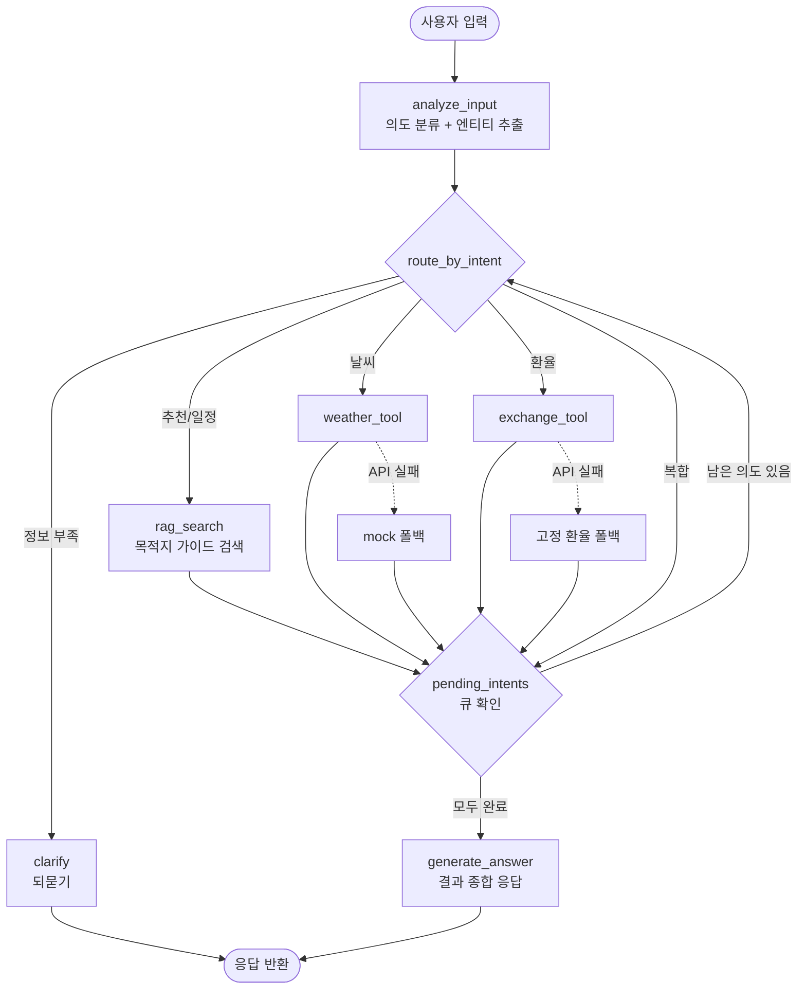

# 스마트 여행 비서 에이전트 기획서

- 문서 버전: v1.0 / 작성일: 2026-10-16
- 관련 문서: 개발서 (요구사항 ID FR-xx / NFR-xx 공유)

---

## 1. 개요 / 목표

**서비스명**: Smart Travel Assistant (스마트 여행 비서)

LangGraph로 구축하는 대화형 여행 비서 에이전트. 사용자의 자연어 질문을 분석해 **목적지 추천(RAG), 날씨 조회, 환율 계산, 일정 제안**을 수행하고 하나의 여행 답변으로 종합한다.

**목표**
1. `State / Node / Edge`를 직접 정의한 LangGraph 워크플로우 완성 (`create_react_agent` 미사용).
2. 조건부 에지로 의도별 분기와 복합 의도의 순차 처리를 구현.
3. 자체 작성한 여행 가이드 md 5개 기반 RAG 파이프라인 구축.
4. 외부 API 실패 시에도 응답이 끊기지 않는 폴백(mock) 구조 확보.

**성공 지표**: 5가지 의도 시나리오 전부 정상 응답, 툴 장애 상황에서도 오류 없이 답변 생성.

## 2. 배경 및 제약

- **배경**: 여행 준비는 정보 탐색(가이드), 날씨, 환율 확인이 여러 앱에 흩어져 있어 번거롭다. 단일 대화로 통합하면 준비 시간이 줄어든다. 또한 본 과제는 LangGraph의 그래프 구조 이해가 학습 목적이다.
- **제약**
  - 고수준 API `create_react_agent` 사용 금지 (NFR-01).
  - RAG 데이터는 직접 작성한 Markdown(.md) 문서 5개로 한정.
  - 과제 원문은 txt를 요구하나, 팀 결정으로 Markdown(.md)으로 작성한다 (front-matter + `##` 섹션 구조로 청킹 품질 향상).
  - API 키는 `.env`로 관리, 코드/저장소에 노출 금지 (NFR-03).
  - 외부 API는 가상(mock) 또는 실제 API 모두 허용. 실습 환경 특성상 무료/무키 수단 우선.
  - 언어: 한국어 입출력 기본. 개발 환경: Python, LangGraph, LangChain, 벡터 스토어(FAISS/Chroma 등).

## 3. 타깃 사용자 / 페르소나

| 페르소나 | 특징 | 니즈 |
|---|---|---|
| 김민지 (29, 직장인) | 첫 해외 자유여행 계획, 목적지 미정 | 취향에 맞는 도시 추천, 예산 감각 |
| 박준호 (35, 출장 겸 여행) | 일정 확정, 출발 임박 | 현지 날씨와 환전 금액을 빠르게 확인 |
| 이서윤 (42, 가족 여행) | 아이 동반, 국내/해외 고민 | 가족 친화 장소, 무리 없는 일정 |
| 과제 평가자/수강생 | 구조 검증 목적 | 그래프 흐름과 폴백 동작의 명확성 |

## 4. 사용자 시나리오

**시나리오 1. 목적지 추천 (의도: 추천)**
```
User: 5월에 3박 4일로 음식 맛집 위주로 갈 만한 해외 도시 추천해줘.
Bot : 가이드 기준으로 도쿄와 방콕을 추천드립니다. 도쿄는 라멘·스시 등 미식 밀집 지역이 많고
      5월 평균 기온 20도 안팎으로 여행하기 좋습니다. 방콕은 길거리 음식과 합리적인 물가가 장점이나
      5월은 덥고 우기가 시작됩니다. 어느 쪽이 더 끌리시나요?
```

**시나리오 2. 날씨 (의도: 날씨)**
```
User: 다음 주 파리 날씨 어때?
Bot : 파리는 최고 18도, 최저 9도의 흐림이며 비 올 확률 40%입니다. 가벼운 겉옷과 우산을 챙기세요.
      (실시간 조회 실패 시: "예시 데이터 기준" 문구를 함께 표기)
```

**시나리오 3. 환율 (의도: 환율)**
```
User: 도쿄 가는데 50만원이면 엔화로 얼마야?
Bot : 적용 환율 1 JPY = 9.1 KRW 기준 약 54,945 JPY입니다. (기준일/출처 표기, 실제 수수료 별도)
```

**시나리오 4. 일정 (의도: 일정)**
```
User: 제주도 2박 3일 일정 짜줘.
Bot : 1일차 공항 -> 애월 해안도로 -> 협재 해변 / 2일차 성산일출봉 -> 섭지코지 -> 동문시장 /
      3일차 한라산 둘레길 -> 공항. 가이드의 이동시간 기준으로 구성했습니다.
```

**시나리오 5. 복합 의도 (추천 + 날씨 + 환율 + 일정)**
```
User: 7월에 뉴욕 5일 여행 가려는데 날씨랑 100만원 달러 환전, 일정도 알려줘.
Bot : [날씨] 평균 29도, 소나기 잦음 / [환율] 100만원 약 $725 / [일정] 1일차 센트럴파크·MET ... 
      (RAG -> 날씨 -> 환율 순차 실행 후 하나의 답변으로 종합)
```

**시나리오 6. 예외 (정보 부족/미지원 목적지)**
```
User: 환율 알려줘.
Bot : 어느 나라(통화)와 금액이 궁금하신가요? 예: "도쿄에서 쓸 50만원".
User: 리스본 추천해줘.
Bot : 현재 가이드에는 도쿄·파리·방콕·뉴욕·제주만 있습니다. 이 중 비슷한 분위기로 파리를 제안드려요.
```

## 5. 기능 요구사항

| ID | 기능 | 설명 | 우선순위 | 수용 기준 |
|---|---|---|---|---|
| FR-01 | 상태 관리 | TypedDict 기반 State 정의: 대화 맥락(messages), 사용자 입력, 의도/추출 엔티티, 툴 결과(weather/exchange), RAG 결과, 처리 대기 의도 큐, 오류 로그 | 필수 | 각 노드가 State만 읽고 갱신하며 전역 변수 미사용. 다중 턴에서 이전 목적지가 유지됨 |
| FR-02 | 사용자 입력 분석 | LLM으로 의도 분류(추천/날씨/환율/일정/복합)와 목적지·통화·금액·날짜 추출. 누락 정보는 되묻기 플래그 | 필수 | 시나리오 문장 20개 중 의도 분류 정확도 90% 이상, 엔티티 추출 JSON 스키마 검증 통과 |
| FR-03 | RAG 목적지 검색 | 가이드 md 5개(도쿄/파리/방콕/뉴욕/제주) 청킹, 임베딩, 벡터 검색 후 상위 k개 근거 반환 | 필수 | 목적지·취향 질의 시 해당 도시 문서가 top-3에 포함, 출처 파일명 State에 기록 |
| FR-04 | 날씨 조회 Tool | 실제 API(예: Open-Meteo/OpenWeather) 호출, 실패/타임아웃 시 mock 데이터로 폴백 | 필수 | 정상 시 기온/강수/요약 반환, API 차단 상태에서도 mock 결과와 `source=mock` 표시 |
| FR-05 | 환율 계산 Tool | KRW 기준 현지 통화(JPY/EUR/THB/USD) 환산, 환율 조회 실패 시 고정 환율표 사용 | 필수 | 금액 변환 오차 0.01 이내(동일 환율 기준), 기준일·출처 표기 |
| FR-06 | 조건부 라우팅 | 의도별 분기 함수로 다음 노드 결정. 복합 의도는 큐 순서대로 순차 실행 후 응답 노드로 이동 | 필수 | 5개 의도 모두 올바른 경로 실행, 복합 의도에서 모든 필요 노드가 1회씩 실행되고 무한 루프 없음(최대 스텝 제한) |
| FR-07 | 최종 응답 생성 | State에 모인 RAG/날씨/환율 결과를 종합해 한국어 답변 생성, 근거와 데이터 출처 명시 | 필수 | 수집된 결과 외 내용을 지어내지 않음, 실패 항목은 안내 문구로 대체 |
| FR-08 | (선택) 되묻기 | 필수 정보 누락 시 clarify 노드에서 질문 | 선택 | 누락 시나리오에서 툴 호출 없이 질문 반환 |
| FR-09 | 지원 여행지 선택·미지원 안내 | 지원 여행지(레지스트리 기준)를 "새 여행 계획" 모달의 라디오 카드로 보여 줌(보드 상단 섹션은 제거). 지원하지 않는 나라·도시를 말하면 "아직 존재하지 않습니다"로 안내하고 선택 카드를 제시 | 필수 | 미지원 지명 질문은 툴 호출 없이 clarify로 끝나고 보드가 바뀌지 않음. 지원 도시와 함께 나오면 정상 답변 뒤에 안내 한 줄 |
| FR-10 | 여행 계획 팝업 | 헤더 "새 여행 계획"과 빈 보드 CTA가 모달(`<dialog>`)을 연다. 한 화면 세 구획: 1 여행지(라디오 카드 5개) / 2 여행 일정(출발일 + 1~5일차 버튼, 기본 3일차, "10/16(금) ~ 10/18(일) · 2박 3일" 실시간 요약) / 3 원하는 장소(여행지 가이드 "주요 명소" 칩 + 쉼표 직접 입력, 비우면 AI 추천). `POST /plan` 검증(지원 여행지, 날짜 형식, 출발일 ≥ 오늘, 일수 1~5, 장소 ≤ 10곳)을 통과하면 새 thread 로 이동해 계획 생성 스트림이 자동 시작 | 필수 | 잘못된 입력은 400 과 안내 문구. 일정(`itinerary`)과 여행기간중 날씨현황(`forecast`)는 정확히 N일 분량. 장소가 비면 가이드 주요 명소로 채우고 `places_auto=True`. 노드 경로 `analyze_input → rag_search → weather_tool → exchange_tool → plan_itinerary → generate_answer` |
| FR-11 | 여행기간중 날씨현황 | 여행 기간의 날짜별 예보. OpenWeather 5일/3시간 예보를 날짜별 집계(최저/최고/상태/강수확률). 예보 범위(약 5일) 밖 날짜는 가이드 "베스트 시즌과 기후"의 계절 문장(예상 기후). 키 없음/실패 시 예시 데이터 | 필수 | 날짜마다 `source`(forecast/climate/mock) 배지로 구분(색만으로 구분하지 않음). 현재 날씨도 유지 |
| FR-12 | 상세 요청 표시 | 계획이 있는 대화에서 "2일차 맛집 더 알려줘", "시부야 쇼핑 정보", "교통 자세히"를 물으면 답변을 말풍선과 보드 "요청한 정보" 카드로 누적. 일차를 말하면 "N일차" 배지와 일정 카드의 "요청한 정보 보기" 링크 | 필수 | 일정/날씨는 다시 계산하지 않음. 새로고침해도 카드가 복원됨. 실행 흐름(노드/ms)은 `?debug=1` 에서만 표시 |
| FR-13 | 랜딩·GNB·내 여행 계획 | `/` 는 모두투어형 구조(검색 헤더, GNB, 히어로 슬라이더, 인기 코스 카드)를 참고한 자체 디자인 랜딩(일러스트, 판매 표현 없음). 공통 GNB(로고→랜딩, 여행지 드롭다운, 검색, 새 여행 계획). 작업실은 `/planner`. 요청한 계획은 브라우저 localStorage 에 저장되어 랜딩에서 다시 열 수 있고, 이 기기에서 삭제할 수 있다 | 선택 | `/` 에 히어로 5장과 인기 코스 카드, `/planner` 200, 지원 도시 검색 시 모달 자동 선택, 미지원 시 안내, 저장본 삭제는 확인 대화상자 후 로컬만 |

## 6. 비기능 요구사항

| ID | 구분 | 내용 | 수용 기준 |
|---|---|---|---|
| NFR-01 | 고수준 API 금지 | `create_react_agent` 등 사전 구성 에이전트 미사용, `StateGraph`로 노드/에지 직접 정의 | 코드 검색 시 해당 호출 0건 |
| NFR-02 | 오류 처리/폴백 | 툴/LLM/검색 예외를 노드 내에서 포착, 재시도(최대 2회) 후 mock/안내 문구로 폴백, 오류를 State에 기록 | 네트워크 차단 테스트에서 그래프가 예외 없이 종료 |
| NFR-03 | 보안/설정 | API 키는 `.env`로 관리, `.env.example` 제공, `.gitignore` 등록 | 저장소에 키 문자열 없음 |
| NFR-04 | 성능 | 단일 의도 응답 10초 이내(LLM 호출 포함, 목표) | 시나리오 1~4 평균 측정 |
| NFR-05 | 관측성 | 노드별 실행 로그(입력 의도, 선택 경로, 폴백 여부) 출력 | 로그만으로 경로 재현 가능 |

## 7. 서비스 흐름



- 복합 의도는 `pending_intents` 큐에 담아 RAG -> 날씨 -> 환율 순으로 하나씩 소비한다.
- 모든 툴 노드는 실패 시 폴백 결과를 State에 기록하고 다음 단계로 진행한다.
- 무한 루프 방지를 위해 `recursion_limit` 및 노드별 실행 횟수 상한을 둔다.

## 8. RAG 문서 기획

공통 목차 구조(각 문서 약 1,500~2,500자, 한국어, 직접 작성): **개요 / 베스트 시즌과 기후 / 추천 여행 스타일 / 대표 명소 / 음식 / 교통 / 예산 / 현지 팁·주의사항 / 추천 일정(2박3일 등)**

| 파일 | 목차 항목 (도시 특화) |
|---|---|
| `tokyo.txt` | 도시 개요 / 시즌별 기후(벚꽃·장마·단풍) / 추천 스타일(미식·쇼핑·애니 문화) / 명소(아사쿠사, 시부야, 신주쿠, 하라주쿠) / 음식(라멘, 스시, 이자카야) / 교통(스이카, JR, 지하철) / 예산(JPY, 환전 팁) / 매너·팁 / 3박4일 일정 |
| `paris.txt` | 도시 개요 / 기후(봄가을 추천, 여름 혼잡) / 추천 스타일(예술·로맨틱·건축) / 명소(에펠탑, 루브르, 몽마르트르, 베르사유) / 음식(크루아상, 와인, 비스트로) / 교통(나비고 패스, 메트로) / 예산(EUR) / 소매치기 주의·박물관 휴관일 / 4박5일 일정 |
| `bangkok.txt` | 도시 개요 / 건기·우기 구분 / 추천 스타일(가성비·미식·마사지·야시장) / 명소(왕궁, 왓포, 짜뚜짝, 카오산) / 음식(팟타이, 똠얌꿍, 길거리 음식) / 교통(BTS, MRT, 그랩) / 예산(THB) / 더위·바가지 주의 / 3박5일 일정 |
| `newyork.txt` | 도시 개요 / 사계절 기후 / 추천 스타일(문화·쇼핑·뮤지컬·야경) / 명소(센트럴파크, 타임스스퀘어, MET, 브루클린 브리지) / 음식(피자, 베이글, 스테이크) / 교통(메트로카드, OMNY) / 예산(USD, 팁 문화) / 안전·ESTA·비자 / 5박7일 일정 |
| `jeju.txt` | 도시(섬) 개요 / 계절별 기후·바람·비 / 추천 스타일(힐링·자연·가족·드라이브) / 명소(성산일출봉, 한라산, 협재, 섭지코지) / 음식(흑돼지, 해산물, 감귤) / 교통(렌터카, 버스) / 예산(KRW, 환율 불필요) / 기상 악화 시 대안 / 2박3일 일정 |

**처리 규칙**: 섹션 헤더 단위 우선 청킹(300~500자, overlap 50), 메타데이터에 `city`, `section`, `source` 저장. 환율·날씨 수치는 문서에 고정하지 않고 툴 결과를 사용한다(문서는 정성 정보 중심).

## 9. 범위

**포함**
- LangGraph StateGraph 기반 단일 에이전트(State/Node/Edge 직접 정의)
- 의도 분류, RAG, 날씨/환율 툴, 조건부 라우팅, 복합 의도 순차 처리, 최종 응답
- md 가이드 5개 작성, CLI(또는 간단한 노트북) 인터페이스(보조로 유지)
- 웹 UI: FastAPI + HTMX 채팅 작업실(여행 보드 + AI 패널), 그래프 실행 흐름 표시(SSE). 화면은 `plans/화면설계.md`, 구현은 개발서 17장
- mock 폴백, `.env` 관리, 기본 테스트 시나리오

**제외**
- 항공/숙소 예약 및 결제, 실시간 가격 비교
- 사용자 계정/장기 기억 DB, 모바일 앱 개발(웹 UI는 포함, 로그인·설정 화면 제외)
- 5개 외 목적지 지원, 다국어 UI
- 환율 수수료/카드 혜택 정밀 계산

## 10. 일정 (마일스톤)

| 단계 | 기간(안) | 산출물 |
|---|---|---|
| M1. 설계 | D1 | 기획서/개발서, State 스키마, 그래프 설계도 |
| M2. 데이터 | D2 | 여행 가이드 md 5개, 임베딩/인덱스 구축 |
| M3. 노드 구현 | D3~D4 | analyze_input, rag_search, weather_tool, exchange_tool, generate_answer |
| M4. 그래프 조립 | D5 | 조건부 에지, 복합 의도 큐, 폴백 연결 |
| M5. 테스트/보완 | D6 | 시나리오 테스트, 오류 주입 테스트, 로그 정리 |
| M5-1. 웹 UI | D6~D7 | FastAPI + HTMX 작업실(`/`), 실행 흐름 SSE, `/dev/components` (화면설계.md, 개발서 17장) |
| M6. 마무리 | D7 | README, 데모 시연, 제출 |

## 11. 리스크와 대응

| 리스크 | 영향 | 대응 |
|---|---|---|
| LLM 의도 분류 오류/JSON 형식 깨짐 | 잘못된 경로 | 구조화 출력(스키마 검증), 실패 시 키워드 규칙 기반 폴백 |
| 외부 API 장애/키 미발급 | 툴 결과 없음 | mock/고정 환율 폴백, `source` 필드로 출처 구분 (NFR-02) |
| 복합 의도 처리 시 루프/누락 | 응답 불완전, 무한 실행 | 의도 큐 + 완료 플래그 + recursion_limit |
| RAG 검색 정확도 부족 | 엉뚱한 추천 | 헤더 기반 청킹, 메타데이터 필터(city), top-k 조정 |
| 문서 5개의 작은 규모 | 추천 다양성 한계 | 도시별 스타일 태그 명시, 범위 외 목적지는 안내 |
| API 키 유출 | 보안 사고 | `.env` + `.gitignore`, 예시 파일만 커밋 (NFR-03) |
| 환각(문서에 없는 정보) | 신뢰도 하락 | 응답 프롬프트에 "수집 결과만 사용" 제약, 출처 표기 |

## 12. 평가 기준 체크리스트

- [ ] FR-01 State에 대화 맥락/입력/툴 결과/중간 데이터 필드가 정의되어 있다
- [ ] FR-02 5개 의도 분류 및 목적지·통화·금액·날짜 추출이 동작한다
- [ ] FR-03 md 5개(도쿄, 파리, 방콕, 뉴욕, 제주)로 RAG 검색이 되고 출처가 기록된다
- [ ] FR-04 날씨 Tool이 동작하며 실패 시 mock으로 폴백한다
- [ ] FR-05 KRW 기준 현지 통화 환산이 정확하다
- [ ] FR-06 조건부 에지로 의도별 분기하고 복합 의도를 순차 처리한다
- [ ] FR-07 수집 결과를 종합한 한국어 최종 답변을 생성한다
- [ ] NFR-01 `create_react_agent` 미사용, StateGraph/Node/Edge 직접 구현
- [ ] NFR-02 오류 주입 시에도 그래프가 정상 종료된다
- [ ] NFR-03 API 키가 `.env`로 분리되고 저장소에 노출되지 않는다
- [ ] 시나리오 1~6 데모가 재현된다
- [ ] 그래프 구조도(mermaid)와 코드가 일치한다
